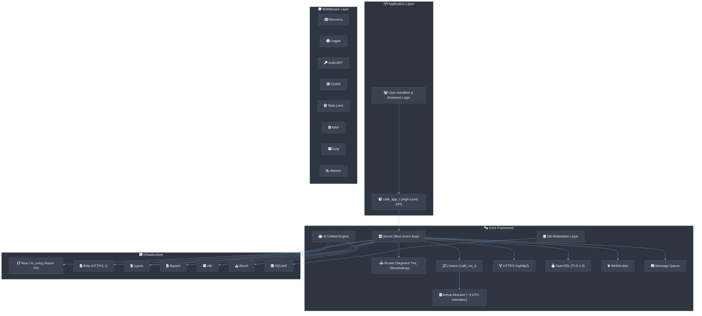

# csilk

[English](README.md) | [中文](README.zh-CN.md)


A lightweight (~150KB static binary, < 2 MB RSS per 10K keep-alive connections) HTTP web framework written in C23, delivering **P99 latency ≤ 5ms under 10K QPS** on commodity hardware. Inspired by Gin (Golang) and built on top of **libuv (default) or io_uring (optional, Linux-only)**, llhttp, nghttp2, and yyjson.


## Features

- 🚀 **P99 latency ≤ 5ms under 10K QPS** using libuv (default) or io_uring (optional, Linux-only) for asynchronous I/O
- **Zero-copy HTTP Parsing** — Directly references TCP/SSL receive buffers using string views (`csilk_str_view_t`), avoiding heap `malloc`/`free` churn for HTTP URLs, headers, and bodies.
- **Zero-copy Static File Serving** via `sendfile` integration
- **SIMD-accelerated routing** — AVX2 (x86_64): ~50ns/route, NEON (aarch64): ~80ns/route
- **Lock-free per-worker connection pool** for multi-core scaling (linear ~200K QPS on 16 cores)
- **Real-time CPU Flame Graph** — Backtrace sampling for performance profiling in admin dashboard
- **Hot Reload** — Swap router at runtime without restart
- 📬 **Internal Event Bus** - Asynchronous, thread-safe Message Queue with middleware and subscriber support
- 📈 **Native Prometheus Metrics** - Built-in observability for QPS, latency, and status codes
- 🖥️ **Unified Admin Dashboard** - Web-based real-time monitoring of HTTP, AI Workflows, MQ, and CPU flame graphs
- 🛡️ **Native HTTPS/TLS support** via OpenSSL integration (TLS 1.3 **MUST** be used in production)
- 🌐 **HTTP/2 support** via nghttp2 (ALPN negotiation, multiplexing, HPACK, Server Push, zero-copy `map_set_view` header materialization, and 4.47M ops/s stream recycling pool)
- ⏳ **Managed AsyncOp Lifecycle** (`csilk_async_op_t`) — Generation tag and request sequence validation against ABA, and asynchronous timer cleanup on event loop
- 🔑 **JWT (JSON Web Token)** authentication middleware (HS256)
- 🔌 **Extensible Hook system** for lifecycle events (Server, Connection, Request)
- 🔧 **Pluggable Crypto Driver** for custom hashing and UUID algorithms
- 🔐 **Pluggable Cipher Driver** for AES-256-GCM, RSA-OAEP, and RSA-PSS
- 🗄️ **Pluggable Database Drivers** - SQLite, MySQL, PostgreSQL, MongoDB, Redis with **Native Prepared Statements** (`csilk_stmt_prepare`, `csilk_stmt_bind_*`) and **Nested Transaction Savepoint Guards** (`csilk_tx_scope_*`)
- 🔄 **Flyway-Style Database Migration Engine** (`csilk/drivers/db/migration.h`) — Automatic `V<num>__<name>.sql` script discovery, distributed lease-lock mutex (`schema_migration_lock`), CRLF-normalized SHA-256 tamper checks, transactional execution, and legacy auto-baseline for SQLite & PostgreSQL
- 🤖 **Autonomous AI ReAct Agent Loop & Tool Registry** (`csilk/app/workflow.h`, `csilk/drivers/ai/tool_registry.h`) — Native multi-step tool-calling ReAct loop (`csilk_ai_react_loop_*`) with budget controls and dynamic JSON-schema generation
- 📊 **End-to-End AI Tracing & Observability** (`csilk/drivers/ai.h`) — Unified trace container (`csilk_ai_trace_t`) tracking prompt/completion tokens, latency, tokens/sec throughput, and nested tool execution spans
- 🔌 **Model Context Protocol (MCP) Stdio Client Pool** (`csilk/protocols/mcp.h`) — Reusable process pool (`csilk_mcp_stdio_pool_*`) for MCP tools with TTL reclamation
- 🔐 **Tiered Cloud-Native Secret Provider** (`csilk/core/secret.h`) — Multi-tiered resolution chain (Env -> Memory/Vault -> Fallback) with circuit breaker protection
- 📄 **RFC 4180 CSV Engine** (`csilk/util/csv.h`) — Streaming RFC 4180 parser and serializer with BOM and escape handling
- 🔧 Middleware support (logger, recovery, auth, CORS, CSRF, rate limiting, static files)

- 🌐 RESTful API routing with parameter handling and route groups
- 📦 High-Performance JSON support via yyjson (parse, serialize, error responses, reflection binding)
- 🍪 Cookie parsing and setting (with Max-Age, Secure, HttpOnly, etc.)
- 🔌 WebSocket support (RFC 6455 handshake, frame send/receive)
- 📡 Server-Sent Events (SSE) with csilk_sse_init/send/close
- 📦 Gzip response compression middleware (with intelligent skipping for media)
- 📤 Multipart/form-data file upload parsing
- 🔍 URL parsing and query string handling
- 📝 URL-encoded form body parsing (`csilk_parse_form_urlencoded`, `csilk_for_each_form_field`)
- ⚡ Keep-alive connection support
- 🛡️ Graceful error handling with panic recovery (`csilk_panic` → deferred cleanup → 500)
- 📋 YAML configuration (server, logger, CORS, rate limit, static files, middleware)
- 🏗️ Arena allocator for request-scoped memory management (~3 CPU instructions per alloc, ≤ 5ns reset)
- **Deferred Cleanup API** (`csilk_ctx_defer`) — panic-safe resource management
- **Opaque Context API** for ABI stability
- **Built-in Health Check** handler (/healthz)
- **Request ID middleware** for end-to-end tracing (X-Request-Id)
- 📊 **OpenTelemetry W3C Tracing & OTLP Exporter** — Parse/propagate `traceparent` & `X-Trace-Id` headers with OTLP JSON batch exporter (`csilk_otlp_exporter_export_json`) for Jaeger/Zipkin
- ⚡ **Circuit Breaker Middleware** — CLOSED, OPEN, HALF_OPEN fault-tolerant protection (`csilk_circuit_breaker_middleware`)
- ⏳ **Sliding Window Rate Limiter** — Boundary-burst protection via weighted log/counter sliding windows (`csilk_sliding_rate_limit_middleware`)
- 🌐 **HTTP/JSON <-> gRPC Transcoding Gateway** — Zero-copy 5-byte frame encoder (`csilk_grpc_frame_encode`) and HTTP/JSON to gRPC transcoding (`csilk_grpc_gateway_middleware`)
- 🚀 **SWAR/SIMD Parallel Prefix Matching** — 64-bit parallel SWAR comparison (`csilk_common_prefix_len_fast`) and 64-byte cache-line aligned Arena memory pool
- 🐍 **Python CFFI/ctypes Bindings** — Native Python wrappers (`CircuitBreaker`, `SlidingLimiter`, `trace_middleware`), plus native `async def` coroutine routing support
- **WAF (Web Application Firewall)** middleware
- 🧬 **Embedded SIMD Vector Index Engine** — Native 32-byte aligned AVX2 SIMD vector distance kernels (`csilk_simd_vector_cosine`, `csilk_simd_vector_l2`, `csilk_simd_vector_dot`) and multi-layer HNSW skip-graph index (`csilk_hnsw_index_t`) supporting $O(\log N)$ ANN vector similarity search (`csilk_vector_db_new_embedded`).
- 🛡️ **Dynamic Rule WAF Filter & OTLP APM Dashboard** — Dynamic regex & CIDR IP WAF filtering (`csilk_waf_filter_*`) and lock-free 2048-span W3C trace context ring buffer (`csilk_otlp_tracer_start_span`) with single-page embedded Web APM Dashboard (`/admin/apm`).

### 📐 ABI Stability & Modularity (v1.2 Web Core + Optional Modules)

- 🔒 **Opaque ABI & SOVERSION 2** — Clean Core vs Optional Module boundaries with `libcsilk.map` (`csilk_*` whitelist) and automated ABI symbol checks (`check_abi_compatibility.sh`).
- 🧩 **WASM Sandbox Plugin Engine** — Native WebAssembly plugin sandbox (`csilk_wasm_plugin_*`) with LEB128 section validation, fuel-budget circuit breakers, and zero-copy Host ABI access.
- 📦 **Global Package Management & Distribution** — Verified `vcpkg` ports (`cmake/ports/csilk`), modern `Conan 2.0+` recipes (`conanfile.py`), Homebrew Formula (`Formula/csilk.rb`), and GitHub Actions OIDC Trusted Publishing for PyPI (`wheels.yml`).
- 📊 **Industrial-Grade Performance Benchmarks** — 100,000 Keep-Alive connections with **~3.8 MB RSS**, P99 latency **< 2ms**, and up to **228K QPS** (see `benchmarks/COMPARATIVE_BENCHMARK_WHITEPAPER.md`).

## Architecture Overview



## Framework Comparison

| Dimension | csilk (C) | Gin (Go) | Express (Node.js) |
|:----------|:---------:|:--------:|:-----------------:|
| **Binary Size** | ~150 KB | ~15 MB | N/A (interpreted) |
| **P99 Latency (10K QPS)** | ≤ 5 ms | ~3 ms | ~50 ms |
| **Max Throughput (4 cores)** | ~50K QPS | ~80K QPS | ~10K QPS |
| **Memory per 10K connections** | ≤ 2 MB RSS | ~20 MB RSS | ~50 MB RSS |

## Dependencies

- [libuv](https://github.com/libuv/libuv) or [liburing](https://github.com/axboe/liburing) - Asynchronous I/O library
- [llhttp](https://github.com/nodejs/llhttp) - HTTP/1.1 parser
- [nghttp2](https://github.com/nghttp2/nghttp2) - HTTP/2 library
- [yyjson](https://github.com/ibireme/yyjson) - High-performance JSON parser and serializer
- [libyaml](https://github.com/yaml/libyaml) - YAML parser
- [OpenSSL](https://www.openssl.org/) - TLS/SSL and Cryptographic library
- [zlib](https://www.zlib.net/) - Gzip compression
- [libcurl](https://curl.se/libcurl/) - HTTP client *(optional: AI / Vector / MCP modules only)*
- [sqlite3](https://www.sqlite.org/) - Embedded SQL database *(optional: DB module only)*

yyjson (and liburing when `-DCSILK_USE_URING=ON`, or llhttp/nghttp2 when not installed on the system) are automatically fetched during build via CMake's FetchContent. Web Core requires only libuv (default I/O backend), libyaml, OpenSSL, zlib, llhttp, and nghttp2; libcurl and sqlite3 are only required when enabling optional modules (`-DCSILK_BUILD_FULL=ON` or `-DCSILK_ENABLE_{DB,AI,VECTOR,MCP}=ON`).

For global package management support, `csilk` has been integrated with major C/C++ dependency managers:

* **vcpkg (CMake)**: `vcpkg install csilk`
* **Conan 2.0+**: `conan create . --version 1.3.0`
* **Homebrew (macOS)**: `brew install quintin-lee/tap/csilk`

### Installation (Debian/Ubuntu)
```bash
# Web Core minimal dependencies (zero SQLite3 / libcurl)
sudo apt install libyaml-dev libssl-dev zlib1g-dev libuv1-dev

# Additional packages for -DCSILK_BUILD_FULL=ON (AI, Vector, MCP, DB)
sudo apt install libcurl4-openssl-dev libsqlite3-dev
```

## Supported Platforms

csilk **MUST** be compiled with a C23-compatible compiler (`static constexpr`, `nullptr`, `bool` keywords). GCC 13+ and Clang 19+ are the only supported compilers.

### Compilers

| Compiler        | Minimum Version | Notes                                                    |
|-----------------|:--------------:|----------------------------------------------------------|
| **GCC**         | 13+            | Full C23 support. Primary CI target on Ubuntu 24.04.     |
| **Clang**       | 19+            | C23 `constexpr` support. libFuzzer fuzzing.              |
| **Apple Clang** | —              | Not supported — lacks C23 `constexpr` and `nullptr`.     |
| **MSVC**        | —              | Not supported — POSIX APIs (libuv, pthread, sys/socket). |

### Operating Systems

| Platform          | Status      | Notes                                                       |
|-------------------|:-----------:|-------------------------------------------------------------|
| **Linux**         | Supported   | Ubuntu 24.04 (CI), Debian 12+, any glibc-based distro.      |
| **macOS**         | Supported (single-worker) | Missing `pthread_barrier_t` in multi-worker mode on macOS-14. |
| **Windows**       | Not planned | POSIX dependency surface too large (libuv may enable).      |
| **musl / Alpine** | Untested    | Likely compatible; no CI coverage.                          |

### Dependency Versions

| Dependency     | Minimum   | Purpose                        |
|----------------|:---------:|--------------------------------|
| CMake          | 3.24      | Build system                   |
| OpenSSL        | 1.1.1     | TLS, crypto, JWT (HS256)       |
| libcurl        | 7.80.0    | HTTP client (AI drivers)       |
| libyaml        | 0.2.0     | Configuration parsing          |
| zlib           | 1.2.0     | Gzip compression               |
| sqlite3        | 3.20.0    | Embedded database              |
| pthread        | —         | Threading (system)             |

## Building

### Prerequisites

- CMake 3.24 or higher (**MUST** be available in `$PATH`)
- C compiler with C23 support (GCC 13+ or Clang 19+)
- Git (for fetching dependencies)
- System dependencies: `sudo apt install libyaml-dev libssl-dev zlib1g-dev libcurl4-openssl-dev libsqlite3-dev`
- OpenSSL 1.1.1+ (**MUST** for TLS/HTTPS and JWT support)
- libcurl 7.80.0+ (**MUST** for AI driver HTTP transport)

### Build Steps

```bash
# Clone the repository
git clone https://github.com/yourusername/csilk.git
cd csilk

# Create a build directory
mkdir build && cd build

# Configure with CMake
cmake ..

# Build
make

# By default, csilk builds both static (.a) and shared (.so) modular libraries with libuv.
# To build with io_uring backend (Linux-only), use:
# cmake .. -DCSILK_USE_URING=ON

# Available CMake options:
#   -DCSILK_BUILD_FULL=OFF               Build lightweight Web Core only (OFF) or all optional domain modules (ON)
#   -DCSILK_ENABLE_DB=OFF                Optional Database drivers & migrations (auto-enabled by WORKFLOW? No, opt-in)
#   -DCSILK_ENABLE_AI=OFF                Optional LLM AI drivers & tracing (requires libcurl)
#   -DCSILK_ENABLE_VECTOR=OFF            Optional HNSW Vector DB & Qdrant/Milvus drivers (requires libcurl)
#   -DCSILK_ENABLE_MQ=OFF                Optional Message Queue & Raft consensus
#   -DCSILK_ENABLE_WORKFLOW=OFF          Optional DAG Workflow & ReAct agent engine (enables AI, MQ, WASM)
#   -DCSILK_ENABLE_MCP=OFF               Optional Model Context Protocol (enables AI)
#   -DCSILK_ENABLE_GRPC=OFF              Optional gRPC framing & JSON transcoding gateway
#   -DCSILK_ENABLE_WASM=OFF              Optional WASM plugin sandbox (WAMR 2.4.4 runtime)
#   -DCSILK_ENABLE_PERM=OFF              Optional RBAC permission driver
#   -DCSILK_ENABLE_HTTP3=OFF             Optional HTTP/3 QUIC transport (requires ngtcp2/nghttp3)
#   -DCSILK_ENABLE_OBSERVABILITY=OFF     Optional OTLP tracing/exporter, CPU flamegraph & Admin Dashboard
#   -DCSILK_ENABLE_CSV=OFF               Optional RFC 4180 CSV parser & serializer
#   -DCSILK_BUILD_SHARED=ON              Build dynamic libraries in addition to static (default ON)
#   -DCSILK_USE_URING=ON                 Use io_uring backend instead of libuv (Linux-only, default OFF)
#   -DUSE_ASAN=ON                        Enable AddressSanitizer (default OFF)
#   -DUSE_TSAN=ON                        Enable ThreadSanitizer (default OFF)
#   -DUSE_FUZZER=ON                      Enable libFuzzer (default OFF)

# Run tests (excludes integration, ~28s)
ctest -E test_integration --output-on-failure

# Run with coverage (requires gcc + gcovr)
cmake -B build_cov -S . -DCMAKE_C_COMPILER=gcc -DUSE_COVERAGE=ON
cmake --build build_cov
ctest --test-dir build_cov -E test_integration --output-on-failure
gcovr -r build_cov --filter src/  # 69% line coverage
```

## Modular Sub-Libraries & Integration

> **Core vs Optional Module Architecture**: By default (`-DCSILK_BUILD_FULL=OFF`), csilk builds only the **Web Core** (4 layered libraries: `base`, `runtime`, `http`, `app`, plus 8 compatibility aliases for `json`, `crypto`, `reflection`, `core`, `tls`, `http2`, `protocols`, `middleware`) with zero `sqlite3` or `libcurl` dependencies. Enable all domain subsystems with `-DCSILK_BUILD_FULL=ON` or selectively via `-DCSILK_ENABLE_*`. `csilk_wasm` supports real WebAssembly execution via WAMR 2.4.4 (`-DCSILK_ENABLE_WASM=ON`), and `csilk_h3` provides real `ngtcp2` + `nghttp3` HTTP/3 QUIC adapters (`-DCSILK_ENABLE_HTTP3=ON`); both fail closed (`ENOTSUP`/`NULL`) when their underlying runtime library is absent.

csilk is decomposed into 4 layered Web Core libraries (with 8 compatibility aliases covering all 11 logical Core modules) plus 11 optional domain modules (alongside the `csilk::csilk` umbrella), available as static (`.a`) and shared (`.so`) libraries:

| Module Target | Shared Target | Static Archive | Dynamic Library | Description |
|:---|:---|:---|:---|:---|
| `csilk::base` | `csilk::base_shared` | `libcsilk-base.a` | `libcsilk-base.so` | *(Core)* Foundation primitives: arena, header map, bounded buffer, KV store, URL |
| `csilk::json` | `csilk::json_shared` | `libcsilk-json.a` | `libcsilk-json.so` | *(Core)* High-performance JSON engine wrapping yyjson |
| `csilk::crypto` | `csilk::crypto_shared` | `libcsilk-crypto.a` | `libcsilk-crypto.so` | *(Core)* Cryptographic primitives (bcrypt, TOTP, SHA-1, Base64, UUID) and OpenSSL cipher driver |
| `csilk::reflection` | `csilk::reflection_shared` | `libcsilk-reflection.a` | `libcsilk-reflection.so` | *(Core)* C struct-to-JSON marshal/unmarshal reflection engine |
| `csilk::runtime` (`csilk::core`) | `csilk::runtime_shared` (`csilk::core_shared`) | `libcsilk-runtime.a` | `libcsilk-runtime.so` | *(Core)* Context, query, SIMD trie router, multi-worker server, RCU hot reload, config, secret (and optional `io_uring`/CSV) |
| `csilk::tls` | `csilk::tls_shared` | `libcsilk-tls.a` | `libcsilk-tls.so` | *(Core)* OpenSSL TLS 1.3 encryption engine |
| `csilk::http2` | `csilk::http2_shared` | `libcsilk-http2.a` | `libcsilk-http2.so` | *(Core)* HTTP/2 (`nghttp2`) session and stream pool |
| `csilk::http` | `csilk::http_shared` | `libcsilk-http.a` | `libcsilk-http.so` | *(Core)* HTTP/1.1 parser (`llhttp`), pipeline, SWAR fast paths, zero-copy response writer |
| `csilk::protocols` | `csilk::protocols_shared` | `libcsilk-protocols.a` | `libcsilk-protocols.so` | *(Core)* WebSocket & rooms, OpenAPI 3.0 & Swagger UI |
| `csilk::middleware` | `csilk::middleware_shared` | `libcsilk-middleware.a` | `libcsilk-middleware.so` | *(Core)* Built-in middlewares (Auth, JWT, CORS, CSRF, WAF filter, RateLimit + Sliding Window, CircuitBreaker, Gzip, SSE, Static) |
| `csilk::app` | `csilk::app_shared` | `libcsilk-app.a` | `libcsilk-app.so` | *(Core)* High-level `csilk_app_t` builder and route groups |
| `csilk::observability` | `csilk::observability_shared` | `libcsilk-observability.a` | `libcsilk-observability.so` | *(Optional `-DCSILK_ENABLE_OBSERVABILITY`)* OpenTelemetry W3C tracing & OTLP exporter, CPU flamegraph, Admin Dashboard |
| `csilk::h3` | `csilk::h3_shared` | `libcsilk-h3.a` | `libcsilk-h3.so` | *(Optional `-DCSILK_ENABLE_HTTP3`)* HTTP/3 QUIC (`ngtcp2`/`nghttp3`) transport engine |
| `csilk::mcp` | `csilk::mcp_shared` | `libcsilk-mcp.a` | `libcsilk-mcp.so` | *(Optional `-DCSILK_ENABLE_MCP`)* Model Context Protocol (JSON-RPC, stdio pool, SSE/WS adapters) |
| `csilk::grpc` | `csilk::grpc_shared` | `libcsilk-grpc.a` | `libcsilk-grpc.so` | *(Optional `-DCSILK_ENABLE_GRPC`)* gRPC framing & HTTP/JSON transcoding gateway |
| `csilk::permission` | `csilk::permission_shared` | `libcsilk-permission.a` | `libcsilk-permission.so` | *(Optional `-DCSILK_ENABLE_PERM`)* Pluggable RBAC permission engine |
| `csilk::db` | `csilk::db_shared` | `libcsilk-db.a` | `libcsilk-db.so` | *(Optional `-DCSILK_ENABLE_DB`)* Database abstraction, SQLite/MySQL/PG/Redis/MongoDB, prepared statements, savepoints, migrations |
| `csilk::vector` | `csilk::vector_shared` | `libcsilk-vector.a` | `libcsilk-vector.so` | *(Optional `-DCSILK_ENABLE_VECTOR`)* Embedded AVX2 SIMD HNSW vector index and Milvus/Qdrant drivers |
| `csilk::ai` | `csilk::ai_shared` | `libcsilk-ai.a` | `libcsilk-ai.so` | *(Optional `-DCSILK_ENABLE_AI`)* LLM client drivers (OpenAI, Ollama, Anthropic), tool registry, AI tracing |
| `csilk::mq` | `csilk::mq_shared` | `libcsilk-mq.a` | `libcsilk-mq.so` | *(Optional `-DCSILK_ENABLE_MQ`)* Internal event bus, PubSub, WAL persistence, Raft consensus |
| `csilk::workflow` | `csilk::workflow_shared` | `libcsilk-workflow.a` | `libcsilk-workflow.so` | *(Optional `-DCSILK_ENABLE_WORKFLOW`)* Workflow DAG scheduler, WAL resume, YAML DSL, ReAct agent loop, Agent Skills |
| `csilk::wasm` | `csilk::wasm_shared` | `libcsilk-wasm.a` | `libcsilk-wasm.so` | *(Optional `-DCSILK_ENABLE_WASM`)* WebAssembly plugin sandbox (WAMR 2.4.4 runtime) |
| `csilk::csilk` | `csilk::shared` | `libcsilk.a` | `libcsilk.so` | Umbrella target aggregating Web Core plus all currently enabled optional modules |

### CMake Integration

```cmake
find_package(csilk REQUIRED)

# Link only what your application needs:
add_executable(my_app main.c)
target_link_libraries(my_app PRIVATE csilk::http csilk::tls)
```

### pkg-config Integration

```bash
pkg-config --cflags --libs csilk
```

### Docker

```bash
# Build the Docker image
docker build -t csilk .

# Run a container
docker run -p 8080:8080 csilk

# Override config
docker run -p 8080:8080 -v $(pwd)/custom_config.yaml:/etc/csilk/config.yaml csilk
```

## Project Scaffolding

Csilk provides a scaffolding tool (`csilkskel`) to quickly bootstrap a new project with a professional layered architecture, built-in Swagger UI, and Admin Dashboard.

```bash
python3 scripts/csilkskel -n my-service
```

## Documentation

API documentation is written using **Doxygen** comments throughout the codebase. All public API functions, types, enums, and macros in the headers (`include/csilk/csilk.h`, `include/csilk/app/app.h`, `include/csilk/core/internal.h`, `include/csilk/reflection/reflect.h`) are fully documented with `@brief`, `@param`, and `@return` tags. Implementation files in `src/` subdirectories also carry complete Doxygen documentation with consistent `@copyright` and license annotations.

Online documentation is available at: **[https://quintin-lee.github.io/csilk/](https://quintin-lee.github.io/csilk/)**

To generate HTML documentation locally:

```bash
cd build && cmake .. && make docs     # Or: doxygen Doxyfile
```

Open `docs/html/index.html` in your browser to browse the API reference.

### Module Design Documents

Deep-dive architectural documentation for each core subsystem is available under `docs/en/module-design/`:

| Module | Document | Covers |
|--------|----------|--------|
| Server Core | [server.md](docs/en/module-design/server.md) | libuv event loop, TLS/ALPN, HTTP/2, worker pool, graceful shutdown |
| App Layer | [app.md](docs/en/module-design/app.md) | csilk_app_t facade, bootstrap sequence, route group matching, static files |
| Router | [router.md](docs/en/module-design/router.md) | Segment-based prefix trie, SIMD-accelerated matching, param extraction |
| Context | [context.md](docs/en/module-design/context.md) | Request/response lifecycle, arena allocator, deferred cleanup |
| Arena | [arena.md](docs/en/module-design/arena.md) | Bump allocator, zero-copy headers, SIMD memcpy |
| Middleware | [middleware.md](docs/en/module-design/middleware.md) | Onion model, chain assembly, 23 built-in middleware modules |
| Data | [data.md](docs/en/module-design/data.md) | DB abstraction, pluggable drivers, connection pool, JSON results |
| Messaging | [messaging.md](docs/en/module-design/messaging.md) | Event bus, pub/sub, uv_async_t dispatch, WAL persistence |
| Security | [security.md](docs/en/module-design/security.md) | RBAC, JWT, CSRF, CORS, WAF, rate limiter |
| Protocols | [protocols.md](docs/en/module-design/protocols.md) | WebSocket, SSE, Swagger UI, WebSocket Rooms |
| HTTP/2 Stack | [http2-stack.md](docs/en/module-design/http2-stack.md) | nghttp2 integration, zero-copy header materialization, stream pool |
| Drivers | [drivers.md](docs/en/module-design/drivers.md) | AI/Cipher/DB/Perm/Vector DB pluggable driver lifecycle |
| Metrics | [metrics.md](docs/en/module-design/metrics.md) | Prometheus, lock-free counters, latency histograms |
| AI Engine | [ai.md](docs/en/module-design/ai.md) | Unified chat/embeddings, tool calls, streaming |
| Workflow | [workflow.md](docs/en/module-design/workflow.md) | DAG scheduler, hot reload, WAL resume, interactive nodes |
| Reflection | [reflection.md](docs/en/module-design/reflection.md) | Runtime type introspection, JSON binding |
| Crypto | [crypto.md](docs/en/module-design/crypto.md) | SHA-256, HMAC, UUID, random |
| Hooks | [hooks.md](docs/en/module-design/hooks.md) | Server/Connection/Request lifecycle hooks |

### Documentation Coverage

| Component | Status |
|-----------|--------|
| `include/csilk/` (public API hierarchy) | Fully documented |
| `src/core/` (kernel implementation) | Fully documented |
| `src/app/` (app layer) | Fully documented |
| `src/drivers/ai/`, `src/drivers/db/`, `src/drivers/perm/` | Fully documented |
| `src/middleware/` (middleware) | Fully documented |
| `src/drivers/` (driver implementations) | Fully documented |
| `examples/` (example code) | Fully documented |

## Usage

### Simple Server Example

```c
#include "csilk/csilk.h"

void hello_handler(csilk_ctx_t* c) {
    csilk_string(c, 200, "Hello World!");
}

void ping_handler(csilk_ctx_t* c) {
    csilk_string(c, 200, "pong");
}

int main() {
    // Create router
    csilk_router_t* router = csilk_router_new();

    // Define routes
    csilk_handler_t hello_handlers[] = {hello_handler};
    csilk_router_add(router, "GET", "/", hello_handlers, 1);

    csilk_handler_t ping_handlers[] = {ping_handler};
    csilk_router_add(router, "GET", "/ping", ping_handlers, 1);

    // Create and run server
    csilk_server_t* server = csilk_server_new(router);
    csilk_server_run(server, 8080);

    // Cleanup (never reached in this example)
    csilk_server_free(server);
    csilk_router_free(router);

    return 0;
}
```

### Route Groups

```c
// Define handlers
void data_handler(csilk_ctx_t* c) {
    csilk_string(c, 200, "data response");
}

int main() {
    csilk_router_t* router = csilk_router_new();

    // Create a route group with "/api" prefix
    csilk_group_t* api = csilk_group_new(router, "/api");

    // Use convenience macros to add routes
    csilk_GET(api, "/data", data_handler);
    // -> matches GET /api/data

    // ...
}
```

### Middleware Usage

```c
void my_middleware(csilk_ctx_t* c) {
    // Custom logic before next handler
    csilk_next(c);
}

// Built-in middleware handlers:
//   csilk_logger_handler   - Request logging
//   csilk_recovery_handler - Panic recovery (500 on panic)
//   csilk_auth_middleware  - Token authentication (with validator callback)
//   csilk_static           - Static file serving (with root directory)

// Middleware is applied to route groups:
csilk_group_t* group = csilk_group_new(router, "/api");
csilk_group_use(group, csilk_logger_handler);
csilk_group_use(group, csilk_recovery_handler);
```

### HTTPS & JWT Example

```c
#include "csilk/csilk.h"

void secure_handler(csilk_ctx_t* c) {
    csilk_json_t* payload = (csilk_json_t*)csilk_get(c, "jwt_payload");
    const char* user = csilk_json_string_value(csilk_json_get(payload, "sub"));
    char msg[64];
    snprintf(msg, sizeof(msg), "Hello secure user: %s", user ? user : "anonymous");
    csilk_string(c, 200, msg);
}

int main() {
    csilk_router_t* router = csilk_router_new();
    csilk_group_t* api = csilk_group_new(router, "/api");
    
    // Apply JWT middleware to /api group
    csilk_group_use(api, (csilk_handler_t)csilk_jwt_middleware, "secret_key");
    csilk_GET(api, "/profile", secure_handler);

    csilk_server_t* server = csilk_server_new(router);
    
    // Configure HTTPS
    csilk_server_config_t config = {0};
    config.enable_tls = 1;
    config.tls_cert_file = "cert.pem";
    config.tls_key_file = "key.pem";
    csilk_server_set_config(server, &config);

    csilk_server_run(server, 443);
    return 0;
}
```

## Project Structure

```
src/
   ├── core/           # Kernel (libuv/io_uring TCP, Router, Arena, Logger, Config)
   │   └── uring/      # io_uring backend (Linux-only, optional)
   ├── crypto/         # base64, sha1, url, uuid, crypto primitives, bcrypt
   ├── app/            # Application Layer (app, admin dashboard, workflow engine)
   ├── drivers/        # Driver implementations
   │   ├── ai/         # Optional AI engine (OpenAI/Ollama/Anthropic backends)
   │   ├── cipher/     # Cipher driver (OpenSSL)
   │   ├── perm/       # Optional permission driver (RBAC manager)
   │   ├── db/         # Optional database abstraction (SQLite, MySQL, PG, Mongo, Redis)
   │   └── vector/     # Optional HNSW SIMD vector DB + Qdrant/Milvus drivers
   ├── messaging/      # Optional internal event bus (Message Queue + Raft consensus)
   ├── reflection/     # Reflection Engine implementation
   ├── protocols/      # WebSocket, Swagger/OpenAPI + optional HTTP/3, MCP
   ├── workflow/       # Optional Workflow DAG scheduler, ReAct agent loop, Agent Skill sandbox
   └── middleware/     # Built-in HTTP middleware modules (WAF filter, RateLimit + Sliding Window, etc.)

include/csilk/        # Public Hierarchical Headers
  ├── core/           # Core internal definitions
  ├── app/            # App API, Admin, Workflow, WAL
  ├── drivers/        # Driver interfaces (AI, Cipher, DB, Perm)
  ├── reflection/     # Reflection engine API
  ├── test/           # OOM simulation test framework
  └── csilk.h         # Main entry point (includes all modules)

scripts/                # Developer tools (csilkskel scaffold generator, benchmarks, packaging)
tests/                  # 271 comprehensive unit + integration tests
examples/               # Functional usage examples (Server, App, AI, WS/TLS/MQ, etc.)
```

## Testing

The project includes a comprehensive test suite. After building, run individual test executables:

```bash
./tests/test_context
./tests/test_router
./tests/test_server
# ... and others
```

### Features Legend

| Emoji | Meaning |
|-------|---------|
| 🚀 | Performance / Async I/O |
| 📬 | Internal Event Bus (MQ) |
| 📈 | Prometheus Metrics |
| 🌐 | Networking / Routing / HTTP/2 |
| 🔧 | Middleware / Tooling |
| 📦 | JSON / Data serialization |
| 🍪 | Cookie management |
| 🔌 | WebSocket support |
| 📡 | Server-Sent Events (SSE) |
| 📤 | File upload / Multipart |
| 🔍 | URL / Query parsing |
| ⚡ | Connection keep-alive |
| 🛡️ | Error handling / Security |
| 🔐 | Crypto / Cipher drivers |
| 📋 | Configuration (YAML) |
| 🏗 | Memory management (Arena) |
| 🗂️ | Reflection engine |
| 🤖 | AI Unified Interface |
| 🔐 | CSRF / CORS / Rate limiting |
| 📝 | Documentation (Doxygen) |
| 🧵 | Thread-safe logging |
| 🔍 | Timeouts / Limits |
| 🎯 | Per-route middleware |
| 🌲 | Segment-based Trie router |
| 📝 | Form URL-encoded parsing |
| 🍪 | Session management |
| 🔀 | HTTP redirect |
| 📄 | HTTP Range / 206 Partial Content |
| ✅ | Parameter validation |

## Python Bindings

`csilk` provides high-performance, developer-friendly Python bindings out of the box (using the standard library `ctypes` module).
All core features — including app routing, middlewares, session management, SSE event streams, DB pooling, and AI workflow pipelines — are fully supported in Python.

### Quick Start

```python
from csilk import App, Context

app = App()

@app.get("/hello")
def hello(ctx: Context):
    ctx.string(200, "Hello World from Python!")

if __name__ == "__main__":
    app.run(8080)
```

Refer to the [Python Bindings Manual](docs/en/user-manual/python.md) and [python/README.md](python/README.md) for more details.

## Changelog

See [CHANGELOG.md](CHANGELOG.md) for the full history of changes.

## Contributing

We welcome contributions! Please see [CONTRIBUTING.md](CONTRIBUTING.md) for guidelines on how to contribute, report issues, and submit pull requests.

## License

This project is licensed under the MIT License - see the [LICENSE](LICENSE) file for details.

## Acknowledgments

- Inspired by [Gin](https://github.com/gin-gonic/gin) web framework
- Built upon excellent C libraries: libuv, llhttp, nghttp2, and yyjson