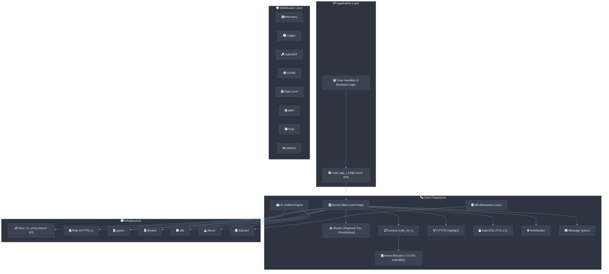

# csilk

[English](README.md) | [中文](README.zh-CN.md)


一个轻量级（静态二进制文件约 150KB，10K 长连接时 RSS 小于 2 MB）的 HTTP Web 框架，用 C23 语言编写，在普通硬件上 **10K QPS 下 P99 延迟 ≤ 5ms**。灵感来自 Gin（Golang），构建于 **libuv（默认）或 io_uring（可选，仅 Linux）**、llhttp、nghttp2 和 yyjson 之上。


## 特性

- 🚀 **10K QPS 下 P99 延迟 ≤ 5ms** — 使用 libuv（默认）或 io_uring（可选，仅 Linux）进行异步 I/O
- **零拷贝 HTTP 解析** — 直接引用 TCP/SSL 接收缓冲区（使用 `csilk_str_view_t`），避免 HTTP URL、请求头和请求体的堆内存 `malloc`/`free` 开销
- **零拷贝静态文件服务** — 通过 `sendfile` 集成实现
- **SIMD 加速路由** — AVX2（x86_64）：约 50ns/路由，NEON（aarch64）：约 80ns/路由
- **无锁 per-worker 连接池** — 多核线性扩展（16 核约 200K QPS）
- **实时 CPU 火焰图** — 管理后台的 Backtrace 采样性能剖析
- **热重载** — 运行时替换路由，无需重启
- 📬 **内部事件总线** — 异步、线程安全的消息队列，支持中间件和订阅者
- 📈 **原生 Prometheus 指标** — 内置 QPS、延迟和状态码可观测性
- 🖥️ **统一管理后台** — 基于 Web 的 HTTP、AI 工作流、MQ 和 CPU 火焰图实时监控
- 🛡️ **原生 HTTPS/TLS 支持** — 通过 OpenSSL 集成（生产环境 **MUST** 使用 TLS 1.3）
- 🌐 **HTTP/2 支持** — 通过 nghttp2（ALPN 协商、多路复用、HPACK、Server Push、`map_set_view` 零拷贝头部物化与 4.47M ops/s 流池复用）
- ⏳ **受管异步操作生命周期** (`csilk_async_op_t`) — 代际标记（Generation Tag）与请求序号校验防 ABA 竞态，事件循环安全关闭定时器
- 🔑 **JWT（JSON Web Token）** 认证中间件（HS256）
- 🔌 **可扩展 Hook 系统** — 覆盖生命周期事件（Server、Connection、Request）
- 🔧 **可插拔加密驱动** — 用于自定义哈希和 UUID 算法
- 🔐 **可插拔密码驱动** — 支持 AES-256-GCM、RSA-OAEP 和 RSA-PSS
- 🗄️ **可插拔数据库驱动** — SQLite、MySQL、PostgreSQL、MongoDB、Redis，配备**原生预编译语句**（`csilk_stmt_prepare`、`csilk_stmt_bind_*`）与**保存点嵌套事务守卫**（`csilk_tx_scope_*`）
- 🔄 **Flyway 风格数据库版本迁移引擎** (`csilk/drivers/db/migration.h`) — 自动化 `V<num>__<name>.sql` 发现、分布式并发租约锁（`schema_migration_lock`）、CRLF 归一化 SHA-256 防篡改校验、事务级执行与存量数据库自动基准化（全面支持 SQLite 与 PostgreSQL）
- 🤖 **自主 AI ReAct Agent 运行循环与工具注册中心** (`csilk/app/workflow.h`, `csilk/drivers/ai/tool_registry.h`) — 原生多步工具调用 ReAct 循环（`csilk_ai_react_loop_*`），配备严格的迭代/超时/Token 预算控制与动态 JSON-Schema 生成
- 📊 **全链路 AI 追踪与可观测性容器** (`csilk/drivers/ai.h`) — 统一追踪容器（`csilk_ai_trace_t`），记录端到端耗时、Token 吞吐率（tokens/sec）、成本核算与嵌套工具跨度
- 🔌 **Model Context Protocol (MCP) Stdio 客户端池** (`csilk/protocols/mcp.h`) — 可复用的外部 MCP 服务进程池（`csilk_mcp_stdio_pool_*`），具备请求流水线与空闲 TTL 优雅回收
- 🔐 **分层云原生 Secret 密钥提供者** (`csilk/core/secret.h`) — 多级密钥解析链（环境 -> 内存/Vault -> 默认），具备缓存与下游熔断器保护
- 📄 **RFC 4180 CSV 高性能解析与序列化引擎** (`csilk/util/csv.h`) — 流式 RFC 4180 解析器，支持字段引号包裹、转义与 BOM 头处理
- 🔧 中间件支持（logger、recovery、auth、CORS、CSRF、限流、静态文件）

- 🌐 RESTful API 路由，支持参数处理和路由组
- 📦 高性能 JSON 支持（通过 yyjson 解析、序列化、错误响应、反射绑定）
- 🍪 Cookie 解析和设置（支持 Max-Age、Secure、HttpOnly 等）
- 🔌 WebSocket 支持（RFC 6455 握手、帧发送/接收）
- 📡 Server-Sent Events（SSE），支持 `csilk_sse_init/send/close`
- 📦 Gzip 响应压缩中间件（智能跳过媒体类型）
- 📤 Multipart/form-data 文件上传解析
- 🔍 URL 解析和查询字符串处理
- 📝 URL-encoded 表单体解析（`csilk_parse_form_urlencoded`、`csilk_for_each_form_field`）
- ⚡ Keep-alive 连接支持
- 🛡️ 完善的错误处理与崩溃恢复（setjmp/longjmp）
- 📋 YAML 配置（server、logger、CORS、限流、静态文件、中间件）
- 🏗️ Arena 分配器，用于请求级内存管理（每次分配约 3 条 CPU 指令，≤ 5ns 重置）
- **延迟清理 API**（`csilk_ctx_defer`）— panic 安全的资源管理
- **不透明上下文 API**（Opaque Context API）— 确保 ABI 稳定性
- **内置健康检查** 处理器（/healthz）
- **请求 ID 中间件** — 端到端追踪（X-Request-Id）
- 📊 **OpenTelemetry W3C 链路追踪与 OTLP 导出器** — 自动解析/透传 `traceparent` 与 `X-Trace-Id` 标头，支持 OTLP JSON 批量导出 (`csilk_otlp_exporter_export_json`) 对接 Jaeger/Zipkin
- ⚡ **Circuit Breaker 熔断器中间件** — 支持 CLOSED/OPEN/HALF_OPEN 三态健康防护 (`csilk_circuit_breaker_middleware`)
- ⏳ **Sliding Window 滑动窗口限流器** — 加权平滑计算，防范窗口边界突发流量 (`csilk_sliding_rate_limit_middleware`)
- 🌐 **HTTP/JSON <-> gRPC 零拷贝转码网关** — 5-Byte 大端帧编码器 (`csilk_grpc_frame_encode`) 与 JSON 到 gRPC 二进制转码 (`csilk_grpc_gateway_middleware`)
- 🚀 **SWAR/SIMD 向量化公共前缀匹配** — 64 位并行比较 (`csilk_common_prefix_len_fast`) 与 64-Byte Cache-Line 对齐 Arena 内存池
- 🐍 **Python CFFI/ctypes 绑定封装** — 原生 Python 封装类 (`CircuitBreaker`, `SlidingLimiter`, `trace_middleware`)，支持原生 `async def` 协程路由
- **WAF（Web 应用防火墙）** 中间件
- 🧬 **原生内嵌式 SIMD 向量检索索引引擎** — 32 字节内存对齐 AVX2 SIMD 距离算子（Cosine / L2 / 向量点积）与多层 HNSW 跳表图索引 (`csilk_hnsw_index_t`)，实现 $O(\log N)$ ANN 近似最近邻向量检索与全零依赖内嵌驱动 (`csilk_vector_db_new_embedded`)
- 🛡️ **动态规则 WAF 过滤器与 OTLP 全链路追踪 Web 仪表盘** — 动态正则与 CIDR IP 过滤引擎 (`csilk_waf_filter_*`) 与 2048-Span W3C 链路追踪无锁环形缓冲区 (`csilk_otlp_tracer_start_span`)，搭配单页嵌入式 Web APM Dashboard (`/admin/apm`)

### 📐 ABI 稳定性与模块化架构 (v2.0 Web Core + 可选域模块)

- 🔒 **不透明 ABI 与 SOVERSION 2** — Web Core 与可选领域模块解耦，配合 `cmake/libcsilk.map`（`csilk_*` 符号白名单）与自动化 ABI 兼容检查 (`check_abi_compatibility.sh`)。
- 🧩 **WASM 沙箱插件引擎** — 原生 WebAssembly 插件沙箱 (`csilk_wasm_plugin_*`)，支持 LEB128 段校验、Fuel 预算熔断及零拷贝 Host ABI 接口。
- 📦 **多语言全局包管理生态** — 提供 `vcpkg` 官方端口 (`cmake/ports/csilk`)、`Conan 2.0+` 配方 (`conanfile.py`)、Homebrew 公式 (`Formula/csilk.rb`) 以及基于 OIDC 的 PyPI 自动发布管线。
- 📊 **工业级性能基准白皮书** — 官方对比 Nginx / Drogon / Actix-web / Go `net/http` 的极限 QPS、确定性尾部延迟 (P99) 及 100,000 长连接内存底噪 (< 4 MB RSS)，详见 `benchmarks/COMPARATIVE_BENCHMARK_WHITEPAPER.md`。

## 架构概览



## 框架对比

| Dimension | csilk (C) | Gin (Go) | Express (Node.js) |
|:----------:|:---------:|:--------:|:-----------------:|
| **二进制大小** | ~150 KB | ~15 MB | N/A（解释型） |
| **P99 延迟（10K QPS）** | ≤ 5 ms | ~3 ms | ~50 ms |
| **最大吞吐量（4 核）** | ~50K QPS | ~80K QPS | ~10K QPS |
| **10K 连接内存占用** | ≤ 2 MB RSS | ~20 MB RSS | ~50 MB RSS |

## 依赖

- [libuv](https://github.com/libuv/libuv) 或 [liburing](https://github.com/axboe/liburing) — 异步 I/O 库
- [llhttp](https://github.com/nodejs/llhttp) — HTTP/1.1 解析器
- [nghttp2](https://github.com/nghttp2/nghttp2) — HTTP/2 库
- [yyjson](https://github.com/ibireme/yyjson) — 高性能 JSON 解析与序列化引擎
- [libyaml](https://github.com/yaml/libyaml) — YAML 解析器
- [OpenSSL](https://www.openssl.org/) — TLS/SSL 和加密库
- [zlib](https://www.zlib.net/) — Gzip 压缩
- [libcurl](https://curl.se/libcurl/) — HTTP 客户端 *（仅可选 AI / Vector / MCP 模块需要）*
- [sqlite3](https://www.sqlite.org/) — 嵌入式 SQL 数据库 *（仅可选 DB 模块需要）*

yyjson（以及 `-DCSILK_USE_URING=ON` 时的 liburing，或系统未安装时的 llhttp/nghttp2）会在构建时通过 CMake 的 FetchContent 自动获取。Web Core 默认构建仅需 libuv（默认 I/O 后端）、libyaml、OpenSSL、zlib、llhttp 与 nghttp2；仅在开启 `-DCSILK_BUILD_FULL=ON` 或对应 `-DCSILK_ENABLE_{DB,AI,VECTOR,MCP}=ON` 时才需要 sqlite3 与 libcurl。

在 C/C++ 依赖管理中，`csilk` 已提供主流的全球包管理生态支持：

* **vcpkg (CMake)**: `vcpkg install csilk`
* **Conan 2.0+**: `conan create . --version 1.0.0`
* **Homebrew (macOS)**: `brew install quintin-lee/tap/csilk`

### 安装（Debian/Ubuntu）
```bash
# Web Core 最小系统依赖（零 SQLite3 / libcurl）
sudo apt install libyaml-dev libssl-dev zlib1g-dev libuv1-dev

# 如需 -DCSILK_BUILD_FULL=ON（AI / Vector / MCP / DB）可额外安装：
sudo apt install libcurl4-openssl-dev libsqlite3-dev
```

## 支持的平台

csilk **MUST** 使用支持 C23 的编译器编译（`static constexpr`、`nullptr`、`bool` 关键字）。仅支持 GCC 13+ 和 Clang 19+。

### 编译器

| 编译器        | 最低版本 | 备注                                                    |
|----------------|:--------:|----------------------------------------------------------|
| **GCC**        | 13+      | 完整 C23 支持。Ubuntu 24.04 上的主要 CI 目标。           |
| **Clang**      | 19+      | 支持 C23 `constexpr`。libFuzzer 模糊测试。               |
| **Apple Clang**| —        | 不支持 — 缺少 C23 `constexpr` 和 `nullptr`。             |
| **MSVC**       | —        | 不支持 — 依赖 POSIX API（libuv、pthread、sys/socket）。  |

### 操作系统

| 平台               | 状态          | 备注                                                       |
|--------------------|:-------------:|-------------------------------------------------------------|
| **Linux**          | 支持          | Ubuntu 24.04（CI）、Debian 12+、任意 glibc 发行版。        |
| **macOS**          | 支持（单 worker） | 多 worker 模式下 macOS-14 缺少 `pthread_barrier_t`。        |
| **Windows**        | 计划中         | POSIX 依赖面太大（libuv 可能使其成为可能）。                |
| **musl / Alpine**  | 未测试        | 可能兼容；无 CI 覆盖。                                      |

### 依赖版本

| 依赖     | 最低版本 | 用途                        |
|----------|:-------:|----------------------------|
| CMake    | 3.24    | 构建系统                   |
| OpenSSL  | 1.1.1   | TLS、加密、JWT（HS256）     |
| libcurl  | 7.80.0  | HTTP 客户端（AI 驱动）      |
| libyaml  | 0.2.0   | 配置解析                   |
| zlib     | 1.2.0   | Gzip 压缩                  |
| sqlite3  | 3.20.0  | 嵌入式数据库               |
| pthread  | —       | 线程（系统级）             |

## 构建

### 前提条件

- CMake 3.24 或更高版本（**MUST** 在 `$PATH` 中可用）
- 支持 C23 的 C 编译器（GCC 13+ 或 Clang 19+）
- Git（用于获取依赖）
- 系统依赖：`sudo apt install libyaml-dev libssl-dev zlib1g-dev libcurl4-openssl-dev libsqlite3-dev`
- OpenSSL 1.1.1+（**MUST**，用于 TLS/HTTPS 和 JWT 支持）
- libcurl 7.80.0+（**MUST**，用于 AI 驱动 HTTP 传输）

### 构建步骤

```bash
# 克隆仓库
git clone https://github.com/yourusername/csilk.git
cd csilk

# 创建构建目录
mkdir build && cd build

# 使用 CMake 配置
cmake ..

# 构建
make

# 默认情况下，csilk 同时构建静态库 (.a) 与动态共享库 (.so)，默认使用 libuv 后端。
# 要构建 io_uring 后端（仅 Linux），使用：
# cmake .. -DCSILK_USE_URING=ON

# 可用 CMake 选项：
#   -DCSILK_BUILD_FULL=OFF                仅构建轻量 Web Core（默认 OFF）或开启全部可选领域模块（ON）
#   -DCSILK_ENABLE_DB=OFF                 可选数据库抽象层与迁移引擎
#   -DCSILK_ENABLE_AI=OFF                 可选 AI LLM 驱动与追踪（需要 libcurl）
#   -DCSILK_ENABLE_VECTOR=OFF             可选 HNSW 向量索引与 Qdrant/Milvus 驱动（需要 libcurl）
#   -DCSILK_ENABLE_MQ=OFF                 可选事件总线、WAL 与 Raft 共识
#   -DCSILK_ENABLE_WORKFLOW=OFF           可选 DAG 工作流与 ReAct Agent 引擎（联动开启 AI/MQ/WASM）
#   -DCSILK_ENABLE_MCP=OFF                可选 Model Context Protocol（联动开启 AI）
#   -DCSILK_ENABLE_GRPC=OFF               可选 gRPC 帧与 HTTP/JSON 转码网关
#   -DCSILK_ENABLE_WASM=OFF               可选 WASM 插件沙箱（配合 -DCSILK_ENABLE_WAMR=ON 启用运行时）
#   -DCSILK_ENABLE_BYPASS=OFF             可选内核旁路 UDP / AF_XDP 扩展
#   -DCSILK_ENABLE_PERM=OFF               可选 RBAC 权限驱动
#   -DCSILK_ENABLE_HTTP3=OFF              可选 HTTP/3 QUIC 传输（需要 ngtcp2/nghttp3）
#   -DCSILK_ENABLE_OBSERVABILITY=OFF      可选 OTLP 链路追踪与导出、CPU 火焰图与管理后台 UI
#   -DCSILK_ENABLE_CSV=OFF                可选 RFC 4180 CSV 解析与序列化引擎
#   -DCSILK_BUILD_SHARED=ON               同时构建动态共享库与静态库（默认 ON）
#   -DCSILK_USE_URING=ON                  使用 io_uring 后端替代 libuv（仅 Linux，默认 OFF）
#   -DUSE_ASAN=ON                         启用 AddressSanitizer（默认 OFF）
#   -DUSE_TSAN=ON                         启用 ThreadSanitizer（默认 OFF）
#   -DUSE_FUZZER=ON                       启用 libFuzzer（默认 OFF）

# 运行测试
ctest --output-on-failure
```

## 模块化子库与集成方式

> **Web Core 与可选模块分层边界**：默认配置（`-DCSILK_BUILD_FULL=OFF`）仅构建轻量 **Web Core**（11 个核心目标：`base`、`json`、`crypto`、`reflection`、`runtime`、`tls`、`http2`、`http`、`protocols`、`middleware`、`app`），对 `sqlite3` 与 `libcurl` 零依赖。通过 `-DCSILK_BUILD_FULL=ON` 或单个 `-DCSILK_ENABLE_*` 可按需启用各领域扩展模块。`csilk_wasm` 在开启 `-DCSILK_ENABLE_WAMR=ON` 时集成真实 WAMR 2.4.4 运行时，`csilk_h3` 在开启 `-DCSILK_ENABLE_HTTP3=ON` 时提供基于 `ngtcp2` + `nghttp3` 的 HTTP/3 QUIC 传输；当底层运行时缺席时均 fail-closed（返回 `ENOTSUP`/`NULL`）。

csilk 由 11 个始终构建的 Web Core 模块与 12 个可选领域模块组成（外加 `csilk::core` 兼容别名与 `csilk::csilk` 伞库），同时提供静态库（`.a`）与动态共享库（`.so`）：

| 模块 Target | 动态库 Target | 静态库归档 | 动态共享库 | 说明 |
|:---|:---|:---|:---|:---|
| `csilk::base` | `csilk::base_shared` | `libcsilk-base.a` | `libcsilk-base.so` | *（核心）* 基础原语：Arena、HeaderMap、有界缓冲、KV 存储、URL |
| `csilk::json` | `csilk::json_shared` | `libcsilk-json.a` | `libcsilk-json.so` | *（核心）* 基于 yyjson 的高性能 JSON 解析与序列化引擎 |
| `csilk::crypto` | `csilk::crypto_shared` | `libcsilk-crypto.a` | `libcsilk-crypto.so` | *（核心）* 密码学原语（bcrypt、TOTP、SHA-1、Base64、UUID）与 OpenSSL 加密驱动 |
| `csilk::reflection` | `csilk::reflection_shared` | `libcsilk-reflection.a` | `libcsilk-reflection.so` | *（核心）* C 结构体与 JSON 自动序列化/反序列化反射引擎 |
| `csilk::runtime` (`csilk::core`) | `csilk::runtime_shared` (`csilk::core_shared`) | `libcsilk-runtime.a` | `libcsilk-runtime.so` | *（核心）* Context、Query、SIMD 字典树路由、多 Worker 服务、RCU 热重载、配置、Secret（及可选 `io_uring`/CSV） |
| `csilk::tls` | `csilk::tls_shared` | `libcsilk-tls.a` | `libcsilk-tls.so` | *（核心）* OpenSSL TLS 1.3 加密传输引擎 |
| `csilk::http2` | `csilk::http2_shared` | `libcsilk-http2.a` | `libcsilk-http2.so` | *（核心）* HTTP/2（`nghttp2`）会话与流池 |
| `csilk::http` | `csilk::http_shared` | `libcsilk-http.a` | `libcsilk-http.so` | *（核心）* HTTP/1.1 解析（`llhttp`）、流水线、SWAR 加速与零拷贝响应写出 |
| `csilk::protocols` | `csilk::protocols_shared` | `libcsilk-protocols.a` | `libcsilk-protocols.so` | *（核心）* WebSocket 与房间广播、OpenAPI 3.0 与 Swagger UI |
| `csilk::middleware` | `csilk::middleware_shared` | `libcsilk-middleware.a` | `libcsilk-middleware.so` | *（核心）* 内置中间件（Auth、JWT、CORS、CSRF、WAF 过滤器、限流/滑动窗口限流、熔断、Gzip、SSE、Static 等） |
| `csilk::app` | `csilk::app_shared` | `libcsilk-app.a` | `libcsilk-app.so` | *（核心）* 高层 `csilk_app_t` 应用构建器与路由组 |
| `csilk::observability` | `csilk::observability_shared` | `libcsilk-observability.a` | `libcsilk-observability.so` | *（可选 `-DCSILK_ENABLE_OBSERVABILITY`）* OpenTelemetry W3C 追踪与 OTLP 导出器、CPU 火焰图与 Admin 管理后台 |
| `csilk::h3` | `csilk::h3_shared` | `libcsilk-h3.a` | `libcsilk-h3.so` | *（可选 `-DCSILK_ENABLE_HTTP3`）* HTTP/3 QUIC（`ngtcp2`/`nghttp3`）协议引擎 |
| `csilk::mcp` | `csilk::mcp_shared` | `libcsilk-mcp.a` | `libcsilk-mcp.so` | *（可选 `-DCSILK_ENABLE_MCP`）* Model Context Protocol（JSON-RPC / stdio 池 / SSE / WS） |
| `csilk::grpc` | `csilk::grpc_shared` | `libcsilk-grpc.a` | `libcsilk-grpc.so` | *（可选 `-DCSILK_ENABLE_GRPC`）* gRPC 帧编解码与 HTTP/JSON 转码网关 |
| `csilk::permission` | `csilk::permission_shared` | `libcsilk-permission.a` | `libcsilk-permission.so` | *（可选 `-DCSILK_ENABLE_PERM`）* 可插拔 RBAC 权限控制引擎 |
| `csilk::db` | `csilk::db_shared` | `libcsilk-db.a` | `libcsilk-db.so` | *（可选 `-DCSILK_ENABLE_DB`）* 数据库抽象层（SQLite/MySQL/PG/Redis/MongoDB）、MVCC 缓存、预编译语句、保存点与迁移引擎 |
| `csilk::vector` | `csilk::vector_shared` | `libcsilk-vector.a` | `libcsilk-vector.so` | *（可选 `-DCSILK_ENABLE_VECTOR`）* 内嵌式 AVX2 SIMD HNSW 向量索引与 Milvus/Qdrant 驱动 |
| `csilk::ai` | `csilk::ai_shared` | `libcsilk-ai.a` | `libcsilk-ai.so` | *（可选 `-DCSILK_ENABLE_AI`）* AI 大模型客户端驱动（OpenAI、Ollama、Anthropic）、工具注册中心与追踪 |
| `csilk::mq` | `csilk::mq_shared` | `libcsilk-mq.a` | `libcsilk-mq.so` | *（可选 `-DCSILK_ENABLE_MQ`）* 异步消息队列、PubSub、WAL 持久化与 Raft 共识引擎 |
| `csilk::workflow` | `csilk::workflow_shared` | `libcsilk-workflow.a` | `libcsilk-workflow.so` | *（可选 `-DCSILK_ENABLE_WORKFLOW`）* Workflow DAG 调度引擎、WAL 恢复、YAML DSL、ReAct Agent 循环与 Skill 沙箱 |
| `csilk::wasm` | `csilk::wasm_shared` | `libcsilk-wasm.a` | `libcsilk-wasm.so` | *（可选 `-DCSILK_ENABLE_WASM`）* WebAssembly 插件沙箱（配合 `-DCSILK_ENABLE_WAMR=ON` 启用 WAMR 2.4.4） |
| `csilk::bypass` | `csilk::bypass_shared` | `libcsilk-bypass.a` | `libcsilk-bypass.so` | *（可选 `-DCSILK_ENABLE_BYPASS`）* 原生 `io_uring` multishot UDP 传输、I/O 性能探针与 AF_XDP 扩展 |
| `csilk::csilk` | `csilk::shared` | `libcsilk.a` | `libcsilk.so` | 聚合 Web Core 与全部已启用可选模块的伞库目标 |

### CMake 业务应用链接

```cmake
find_package(csilk REQUIRED)

# 业务应用仅需链接所需的模块子库：
add_executable(my_app main.c)
target_link_libraries(my_app PRIVATE csilk::http csilk::tls)
```

### pkg-config 集成

```bash
pkg-config --cflags --libs csilk
```

### Docker

```bash
# 构建 Docker 镜像
docker build -t csilk .

# 运行容器
docker run -p 8080:8080 csilk

# 覆盖配置
docker run -p 8080:8080 -v $(pwd)/custom_config.yaml:/etc/csilk/config.yaml csilk
```

## 项目结构

```
src/
   ├── core/           # 内核（libuv/io_uring TCP、Router、Arena、Logger、Config）
   │   └── uring/      # io_uring 后端（仅 Linux，可选）
   ├── crypto/         # base64、sha1、url、uuid、加密原语、bcrypt
   ├── app/            # 应用层（app、admin dashboard、workflow engine）
   ├── drivers/        # 驱动实现
   │   ├── ai/         # （可选）AI 引擎（OpenAI/Ollama/Anthropic 后端）
   │   ├── cipher/     # 密码驱动（OpenSSL）
   │   ├── perm/       # （可选）权限驱动（RBAC 管理器）
   │   ├── db/         # （可选）数据库抽象（SQLite、MySQL、PG、Mongo、Redis）
   │   └── vector/     # （可选）内嵌 HNSW SIMD 向量库 + Qdrant/Milvus 驱动
   ├── messaging/      # （可选）内部事件总线（消息队列 + Raft 共识）
   ├── reflection/     # 反射引擎实现
   ├── protocols/      # WebSocket、Swagger/OpenAPI 与可选 HTTP/3、MCP
   ├── workflow/       # （可选）Workflow DAG 调度器、ReAct Agent 循环、Agent Skill 沙箱
   └── middleware/     # 内置 HTTP 中间件模块（WAF 过滤器、限流 + 滑动窗口限流等）

include/csilk/        # 公共分层头文件
  ├── core/           # 核心内部定义
  ├── app/            # App API、Admin、Workflow、WAL
  ├── drivers/        # 驱动接口（AI、Cipher、DB、Perm）
  ├── reflection/     # 反射引擎 API
  ├── test/           # OOM 模拟测试框架
  └── csilk.h         # 主入口（包含所有模块）

scripts/                # 开发者工具（csilkskel 脚手架生成器、基准测试、打包脚本）
tests/                  # 271 个全面的单元与集成测试
examples/               # 功能示例（Server、App、AI、WS/TLS/MQ 等）
```

### 模块设计文档

核心子系统的深度架构设计文档位于 `docs/zh-CN/module-design/`：

| 模块 | 文档 | 涵盖内容 |
|--------|----------|--------|
| 服务端内核 | [server.md](docs/zh-CN/module-design/server.md) | libuv/io_uring 事件循环、TLS/ALPN、Worker 线程池、优雅停机 |
| 应用层 | [app.md](docs/zh-CN/module-design/app.md) | csilk_app_t 门面、启动流程、路由组匹配、静态文件分发 |
| 路由系统 | [router.md](docs/zh-CN/module-design/router.md) | 分段前缀树、SIMD 加速匹配、参数提取 |
| 上下文 Context | [context.md](docs/zh-CN/module-design/context.md) | 请求/响应生命周期、Arena 分配器、延迟清理、异步操作生命周期 |
| 内存池 Arena | [arena.md](docs/zh-CN/module-design/arena.md) | Bump 分配器、零拷贝请求头、SIMD 内存拷贝 |
| 中间件 | [middleware.md](docs/zh-CN/module-design/middleware.md) | 洋葱模型、调用链组装、23 个内置中间件 |
| 数据访问 | [data.md](docs/zh-CN/module-design/data.md) | DB 抽象层、可插拔驱动、连接池 |
| 消息总线 | [messaging.md](docs/zh-CN/module-design/messaging.md) | 事件总线、Pub/Sub、uv_async_t 派发、WAL 持久化、Raft 共识 |
| 安全系统 | [security.md](docs/zh-CN/module-design/security.md) | RBAC、JWT、CSRF、CORS、WAF 防火墙、滑动窗口限流 |
| 协议扩展 | [protocols.md](docs/zh-CN/module-design/protocols.md) | WebSocket、SSE、Swagger UI、WebSocket 房间 |
| HTTP/2 协议栈 | [http2-stack.md](docs/zh-CN/module-design/http2-stack.md) | nghttp2 集成、零拷贝请求头物化、流回收池 |
| 驱动架构 | [drivers.md](docs/zh-CN/module-design/drivers.md) | AI/Cipher/DB/Perm/Vector DB 可插拔驱动生命周期 |
| 监控指标 | [metrics.md](docs/zh-CN/module-design/metrics.md) | Prometheus 指标、无锁计数器、延迟直方图 |
| AI 引擎 | [ai.md](docs/zh-CN/module-design/ai.md) | 统一对话/嵌入、工具调用、SSE 流式输出 |
| 任务流工作流 | [workflow.md](docs/zh-CN/module-design/workflow.md) | DAG 调度器、热重载、WAL 断点续传、交互节点 |
| 反射引擎 | [reflection.md](docs/zh-CN/module-design/reflection.md) | 运行时类型自省、JSON 结构体自动绑定 |
| 加密原语 | [crypto.md](docs/zh-CN/module-design/crypto.md) | SHA-256、HMAC、UUID、随机数、AES/RSA 加密驱动 |
| 生命周期钩子 | [hooks.md](docs/zh-CN/module-design/hooks.md) | Server/Connection/Request 级生命周期钩子 |

## 测试

项目包含一个全面的测试套件。构建后，运行各个测试可执行文件：

```bash
./tests/test_context
./tests/test_router
./tests/test_server
# ... 等等
```

### 特性图例

| Emoji | 含义 |
|-------|------|
| 🚀 | 性能 / 异步 I/O |
| 📬 | 内部事件总线（MQ） |
| 📈 | Prometheus 指标 |
| 🌐 | 网络 / 路由 / HTTP/2 |
| 🔧 | 中间件 / 工具 |
| 📦 | JSON / 数据序列化 |
| 🍪 | Cookie 管理 |
| 🔌 | WebSocket 支持 |
| 📡 | Server-Sent Events（SSE） |
| 📤 | 文件上传 / Multipart |
| 🔍 | URL / 查询解析 |
| ⚡ | 连接保持活跃（Keep-alive） |
| 🛡️ | 错误处理 / 安全 |
| 🔐 | 加密 / 密码驱动 |
| 📋 | 配置（YAML） |
| 🏗 | 内存管理（Arena） |
| 🗂️ | 反射引擎 |
| 🤖 | AI 统一接口 |
| 🔐 | CSRF / CORS / 限流 |
| 📝 | 文档（Doxygen） |
| 🧵 | 线程安全日志 |
| 🔍 | 超时 / 限制 |
| 🎯 | 每路由中间件 |
| 🌲 | 分段前缀树（Segment Trie）路由 |
| 📝 | Form URL-encoded 解析 |
| 🍪 | 会话管理 |
| 🔀 | HTTP 重定向 |
| 📄 | HTTP Range / 206 Partial Content |
| ✅ | 参数验证 |

## Python 绑定

`csilk` 提供开箱即用的高性能、开发者友好的 Python 绑定（使用标准库 `ctypes` 模块）。
所有核心功能 — 包括 app 路由、中间件、会话管理、SSE 事件流、DB 连接池和 AI 工作流管道 — 在 Python 中均完全支持。

### 快速开始

```python
from csilk import App, Context

app = App()

@app.get("/hello")
def hello(ctx: Context):
    ctx.string(200, "Hello World from Python!")

if __name__ == "__main__":
    app.run(8080)
```

更多细节请参阅 [Python 绑定手册](docs/zh-CN/user-manual/python.md) 和 [python/README.md](python/README.md)。

## 更新日志

完整的变更历史请参阅 [CHANGELOG.zh-CN.md](CHANGELOG.zh-CN.md) 与 [CHANGELOG.md](CHANGELOG.md)。

## 贡献

欢迎贡献！请参阅 [CONTRIBUTING.md](CONTRIBUTING.md) 了解如何贡献、报告问题和提交拉取请求的准则。

## 许可证

本项目采用 MIT 许可证 — 详情请参阅 [LICENSE](LICENSE) 文件。

## 致谢

- 灵感来自 [Gin](https://github.com/gin-gonic/gin) Web 框架
- 构建于优秀的 C 语言库之上：libuv、llhttp、nghttp2 和 yyjson
