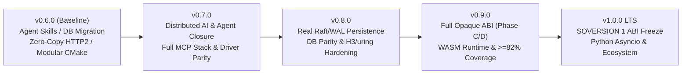

# csilk Roadmap (v0.6.2 → v1.0.0 LTS)

> **Baseline**: `0.6.2` | **Planned**: `2026-11-13` | **Target Milestone**: `v1.0.0 LTS`  
> [English](ROADMAP.md) | [中文](../../zh-CN/meta/ROADMAP.md)

---

## 1. Current Baseline & Gap Inventory (v0.6.2)

`v0.6.2` established the modular CMake target DAG, zero-copy HTTP/1.1 & HTTP/2 paths, three major relational databases (SQLite / PostgreSQL / MySQL) with native prepared statements and Flyway-style database migrations, live database container CI tests, Anthropic-semantics Agent Skills (L1/L2/L3 with remote MQ execution and result collection), an autonomous ReAct tool-calling loop, an MCP stdio process pool and live tool-discovery registry bridge, and full cross-platform CI (Ubuntu 24.04 + macOS 15 ARM64 + Wheel packaging).

A codebase audit shows the following remaining items to address on the road to `v1.0.0 LTS`:

| Area | Current State / Known Gap | Primary Files |
| :--- | :--- | :--- |
| **Workflow Cluster SM** | Node association and dispatch validation remain in-memory placeholders without WAL durability or cross-node recovery | `src/workflow/wf_cluster_sm.c` |
| **MCP Server Full-Stack** | Server returns `Method not implemented` on several endpoints; only stdio pool and basic HTTP POST transport exist (no remote persistent SSE / Streamable HTTP) | `src/protocols/mcp/mcp_server.c` |
| **LLM Driver Parity** | `openai.c` supports streamed `tool_calls` reassembly and usage tracking; `ollama.c` lacks parity; no native Anthropic Messages API driver yet | `src/drivers/ai/` |
| **Raft Durability** | `raft_wal.c` and `raft_snapshot.c` are in-memory index-advancing stubs rather than disk-persisted logs/snapshots | `src/messaging/raft_wal.c`, `raft_snapshot.c` |
| **Distributed Rate-Limit TTL** | Storage `incr` does not return remaining window TTL, forcing `ratelimit.c` to fall back to the full window for `Retry-After` | `src/middleware/sliding_ratelimit.c`, `src/middleware/ratelimit.c` |
| **WASM / WASI Sandbox** | Currently limited to magic-number checks and minimal host-import stubs without a bytecode execution engine (such as WAMR) | `src/core/plugin/wasm_plugin.c`, `wasm_wasi.c` |
| **OTLP Trace Closure** | `otlp_trace.c` contains a reserved no-op stub; automatic HTTP → DB → AI/Tool child span propagation is incomplete | `src/middleware/otlp_trace.c` |
| **ABI Opaque Closure** | Phases A & B are complete; [ABI Opaque Roadmap](../design/abi-opaque-roadmap.md) Phase C (tests/examples migration) and Phase D (internalizing layout headers, locking SOVERSION 1) remain | `include/csilk/`, `cmake/libcsilk.map` |

---

## 2. Release Progression Overview

---

## 3. Phased Milestones

### Phase 1: v0.7.0 — Distributed AI / Agent Closure & Protocol Completeness

**Objective**: Replace prototype placeholders in the AI and workflow subsystems with a production-ready local and clustered agent runtime.

1. **Remote Agent Skill Execution Closure (`src/workflow/skill.c`)**
   - Implement the worker-side `csilk.skill.invoke` subscriber: validate request → run bounded `csilk_skill_exec_local()` → publish `stdout` / `exit_code` / `truncated` to `csilk.skill.result`.
   - Implement non-blocking result collection on `csilk_async_op_t`, `idem`-key deduplication cache, and timeout-based failover retry on the caller side.
2. **Workflow Cluster State Machine (`src/workflow/wf_cluster_sm.c`)**
   - Replace in-memory placeholders with a WAL + `csilk_mq`-backed DAG execution state machine supporting crash recovery for long-running Agent and Human-in-the-Loop (HITL) nodes.
3. **Full-Stack MCP Support (`src/protocols/mcp/`)**
   - Upgrade `mcp_client.c` to parse remote `tools/list` JSON schemas and register live handlers into `csilk_tool_registry_t`, removing placeholder tools.
   - Complete `mcp_server.c` handlers for `resources/list`, `resources/read`, `prompts/list`, and `prompts/get`, removing `Method not implemented` responses.
   - Add **MCP over SSE / Streamable HTTP** transport alongside the existing stdio process pool under a unified transport interface.
4. **LLM Driver Parity & Native Anthropic Driver (`src/drivers/ai/`)**
   - Add a native **Anthropic Messages API** driver (streaming tool use, prompt-caching headers, token accounting) to pair natively with Anthropic-semantics Agent Skills.
   - Bring `ollama.c` to feature parity with `openai.c` for streamed `delta.tool_calls` reassembly and `csilk_ai_trace_t` throughput metrics.

**Exit Criteria**:
- Multi-node MQ integration test covering remote skill round-trip, idempotent replay, and timeout failover;
- MCP client/server test suite covering `tools/call`, `resources/read`, and SSE/HTTP transport.

---

### Phase 2: v0.8.0 — Storage / Consensus Persistence & High-Performance I/O

**Objective**: Replace in-memory persistence stubs with durable disk implementations and bring all database drivers and I/O backends to parity.

1. **Durable Raft WAL & Snapshots (`src/messaging/raft_wal.c`, `raft_snapshot.c`)**
   - Reuse the `mq_wal.c` CRC32-framed binary log format for Raft append entries, configurable batch `fsync` policies, and atomic `currentTerm`/`votedFor` persistence.
   - Implement periodic snapshot creation (atomic rename), log compaction, and follower `InstallSnapshot` recovery.
2. **Database & Rate-Limit Storage Parity (`src/drivers/db/`, `src/middleware/`)**
   - Implement native `stmt_prepare` / `MYSQL_STMT` typed bindings in `mysql.c` so `csilk_migration_t` distributed locks and migrations work uniformly across SQLite, PostgreSQL, and MySQL.
   - Extend `csilk_storage_driver_t` atomic `incr` to return remaining window TTL (wired to Redis `PTTL`) so distributed rate limiters emit exact `Retry-After` headers.
3. **Multi-Worker Pool Cleanup & `io_uring` / HTTP/3 Hardening (`src/core/server/`, `src/core/uring/`, `src/protocols/h3.c`)**
   - Resolve the retained `connection_pool.c` / `arena.c` allocations observed on exit in `test_multi_worker` under GCC ASAN, ensuring zero-leak multi-worker teardown.
   - Add real `io_uring` CI integration coverage for `uring_vector.c` (`writev` zero-copy responses) and `uring_sqpoll.c`, removing them from `.gcovr` exclusions.
   - Pair the existing HTTP/3 Varint/Frame codecs in `h3.c` with an optional QUIC transport adapter (e.g., `ngtcp2` + OpenSSL 3.5 QUIC API) for experimental end-to-end HTTP/3 traffic.

**Exit Criteria**:
- 3-node Raft kill-and-restart recovery test passes with zero committed-entry loss;
- Containerized MySQL prepared statement and migration CI tests pass;
- `test_multi_worker` passes cleanly under ASAN + LSan.

---

### Phase 3: v0.9.0 — Full Opaque ABI, Real WASM Runtime & Coverage Sprint

**Objective**: Complete the final breaking cleanups ahead of `v1.0.0` ABI freeze and raise verification coverage to release-candidate standards.

1. **Complete Opaque ABI Phases C & D ([ABI Opaque Roadmap](../design/abi-opaque-roadmap.md))**
   - **Phase C**: Migrate the remaining 30+ tests and examples from direct struct field access to `csilk_get_*` / `csilk_set_*` accessors and validate with `CSILK_DEPRECATE_CTX_TYPES`.
   - **Phase D**: Move `ctx_types.h` and internal layout headers from `include/csilk/` into `src/core/internal/`; tighten `cmake/libcsilk.map` so public headers expose 100% opaque handles only.
2. **Real WASM / WASI Plugin Runtime (`src/core/plugin/`)**
   - Integrate **WAMR (WebAssembly Micro Runtime)** behind an optional CMake flag (`-DCSILK_ENABLE_WAMR=ON`), replacing stubs in `wasm_plugin.c` and `wasm_wasi.c`.
   - Enforce per-invocation memory caps, instruction/fuel budgets (preventing runaway loops on worker threads), and zero-copy host ABI access to request headers/body/status with hot-reload support.
3. **End-to-End OTLP Tracing & 82%+ Line Coverage**
   - Implement the reserved hook in `src/middleware/otlp_trace.c` to propagate `traceparent` automatically across `HTTP Request` → `DB Query` → `AI / MCP / Tool` child spans and surface them in `/admin/apm`.
   - Add libFuzzer harnesses `fuzz_mcp` (JSON-RPC framing), `fuzz_h2` (HTTP/2 frame state machine), and `fuzz_sql_rewrite` (`?` → `$N` rewriting); raise total line coverage from **69%** to **≥ 82%**.

**Exit Criteria**:
- Header-only public API check verifies zero internal struct exposure under `include/csilk/`;
- Line coverage ≥ 82% and all 7 libFuzzer harnesses pass sustained 120s runs without ASAN/UBSAN findings.

---

### Phase 4: v1.0.0 LTS — ABI Freeze & Ecosystem Delivery

**Objective**: Deliver a Long-Term Support release with strict binary compatibility guarantees and turnkey packaging across C and Python ecosystems.

1. **SOVERSION 1 Freeze & Automated ABI Gate**
   - Bump `CSILK_VERSION` to `1.0.0`, lock `SOVERSION = 1`, and add a CI `libabigail` (`abidiff`) job comparing every PR against the `v1.0.0` ABI baseline.
2. **Package Manager Distribution**
   - Upstream `cmake/ports/csilk` to the official **vcpkg** registry; add a Conan Center recipe, a Homebrew Tap (`quintin-lee/tap/csilk`), and Debian/Ubuntu PPA packaging scripts.
3. **Python Bindings Modernization & PyPI Automation (`python/`)**
   - Ship PEP 561 `.pyi` type stubs for `mypy`/`pyright` and an `asyncio`-compatible bridge for Python handlers and AI workflows.
   - Wire PyPI Trusted Publishing (OIDC) into `.github/workflows/wheels.yml` so `v*` tags automatically publish `manylinux_2_34` (Linux x86_64) and `arm64` (macOS) wheels.
4. **Developer Tooling & v1.0 Benchmark Report**
   - Upgrade `scripts/csilkskel` and `scripts/generate-sdk.py` to scaffold JWT + DB migration + OpenAPI + AI Agent services and retry-capable TypeScript/Python client SDKs.
   - Publish a reproducible `v1.0` benchmark whitepaper comparing `csilk` (`libuv` and `io_uring`) against Nginx, Drogon, Go `net/http`, and Actix-web on 16-core hardware.

---

## 4. Immediate Action Queue (v0.7.0-alpha Starting Point)

| Priority | Area | Action Item | Key Files |
| :--- | :--- | :--- | :--- |
| **P0** | Memory Safety | Fix retained `connection_pool.c` / `arena.c` leaks on exit in `test_multi_worker` under GCC ASAN | `src/core/server/connection_pool.c`, `src/core/primitives/arena.c` |
| **P0** | AI / Agent | Implement worker-side MQ subscriber and `csilk.skill.result` timeout/idempotent collection for `csilk_ai_skill_invoke_remote` | `src/workflow/skill.c`, `tests/drivers/test_ai_skill.c` |
| **P1** | Protocols / MCP | Wire `mcp_client.c` `tools/list` schemas into `csilk_tool_registry_t` and remove placeholder tools | `src/protocols/mcp/mcp_client.c`, `src/drivers/ai/tool_registry.c` |
| **P1** | Database | Implement native `MYSQL_STMT` `stmt_prepare` bindings so migrations run uniformly on MySQL | `src/drivers/db/mysql.c`, `src/drivers/db/migration/` |
| **P2** | Consensus / WAL | Persist Raft WAL entries with CRC32 framing and `fsync` in `raft_wal.c` | `src/messaging/raft_wal.c`, `src/messaging/raft_snapshot.c` |
