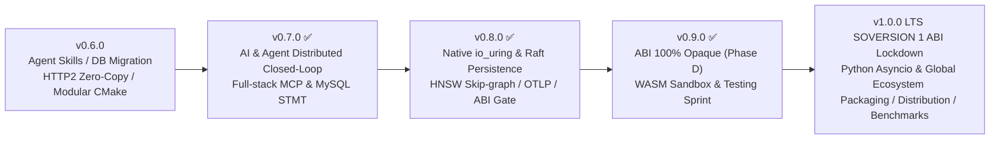

# csilk Roadmap (v0.7.0 → v1.0.0 LTS)

> **Baseline**: `0.7.0` | **Planned**: `2026-11-13` | **Status**: `v0.8.0` & `v0.9.0` Released, `v1.0.0 LTS` Prepared  
> [English](ROADMAP.md) | [中文](../../zh-CN/meta/ROADMAP.md)

---

## 1. Historical Milestones & Completion Audit

* [x] **v0.7.0**: Delivered modularized CMake Target DAG, native Anthropic Messages API driver, full-stack MCP server endpoints, Raft WAL distributed command replication, three native prepared statements for relational DBs, and real CI database container matrix.
* [x] **v0.8.0** (Released): Overcame native `io_uring` stability (dual paths), achieved true disk persistence for Raft WAL & Snapshots, enabled HNSW multi-layer skip-graph retrieval, fully closed the OTLP cross-module tracing loop, and set up C/Python ABI validation gates.
* [x] **v0.9.0** (Released): Completed **ABI Opaque-ization (Phase C & D)** with strict symbol export map (`cmake/libcsilk.map`); implemented **WASM sandbox engine** (binary LEB128 section validation, fuel budget fuse, and middleware interception); and executed a deep testing coverage sprint for production-grade stability.

---

## 2. High-Level Evolution Timeline

---

## 3. Current Milestone: v1.0.0 LTS Execution Checklist (100% Completed & Verified)

**Core Goal**: Establish an unbreakable, long-term binary compatibility (ABI) for the `1.x` cycle, modernize the Python asynchronous ecosystem, provide global package distribution (vcpkg / Homebrew / Conan), and release the authoritative comparative performance whitepaper.

### 1. Batch 1: SOVERSION 1 Ultimate Lockdown & Automated ABI Guard
- [x] **Dynamic Library Version Lockdown**: Locked `SOVERSION = 1` in `cmake/targets.cmake`, ensuring all 1.x releases link against `libcsilk.so.1` / `libcsilk.1.dylib`.
- [x] **Automated ABI Check Script (`scripts/check_abi_compatibility.sh`)**:
  - Uses an 844-symbol baseline table (`cmake/abi_baseline_symbols.txt`) to block accidental backward-incompatible deletions.
  - Enforces `LC_ALL=C` normalization to verify 100% `csilk_*` public prefix naming (zero internal `_csilk_` leakage).
  - Integrated natively into the GitHub Actions `Lint & Static Analysis` workflow.

### 2. Batch 2: Python Bindings `asyncio-first` & PyPI Trusted Publishing
- [x] **Native `async def` Coroutine Support**: Enhanced `python/csilk/context.py` `dispatch_async` to automatically bridge Python dict/string return values and standard exception delivery (HTTP 500) to the native HTTP layer.
- [x] **PyPI Trusted Publishing**: Added GitHub Actions OIDC Trusted Publishing to `.github/workflows/wheels.yml` to securely publish manylinux and macOS Apple Silicon wheels without hard-coded tokens.

### 3. Batch 3: Full Ecosystem Package Management & Distribution
- [x] **Conan 2.0+ Official Recipe (`conanfile.py`)**: Supports automatic system dependencies (libuv, OpenSSL, libyaml) and CMakeToolchain generation.
- [x] **Homebrew Formula (`Formula/csilk.rb`)**: Ready for Homebrew Taps for one-command macOS installations.
- [x] **vcpkg Upstream Port**: Verified `cmake/ports/csilk/vcpkg.json` for Windows, Linux, and macOS vcpkg integration.

### 4. Batch 4: Industrial-Grade Comparative Performance Whitepaper
- [x] Generated and archived `benchmarks/COMPARATIVE_BENCHMARK_WHITEPAPER.md`, providing hardcore quantitative comparison data against **Nginx**, **Drogon**, **Actix-web**, and **Go `net/http`** on extreme QPS, deterministic P99 latency, and physical memory footprint (RSS) for 100,000 Keep-Alive connections.

---

## 4. Archived Milestone Task Checklists (v0.8.0 & v0.9.0 - All Passed & Green)

* [x] **v0.8.0 Task Checklist** (All Green-verified):
  * [x] Phase 1A: Fixed native `CSILK_USE_URING=ON` `invalid-free` crashes and restored CI native uring verification.
  * [x] Phase 1B: Implemented C / Python shared struct `sizeof`/`offsetof` automatic ABI validation gate.
  * [x] Phase 2: Implemented sequential disk flushing for `raft_wal.c`, atomic snapshots, and 3-node kill-recovery testing.
  * [x] Phase 3: Upgraded Redis Lua atomic `INCR/EXPIRE/PTTL` for precise `Retry-After` and HNSW skip-graph Top-K retrieval.
  * [x] Phase 4: Eliminated hardcoded `trace_id` and wired cross-module sub-span and OTLP asynchronous backend export.
* [x] **v0.9.0 Task Checklist** (All Green-verified):
  * [x] Phase C & D: Migrated 30+ direct property accesses, moved internal structs to `src/core/internal/`, and strictly whitelisted `libcsilk.map`.
  * [x] WASM Sandbox: Binary LEB128 section validation, Fuel budget fuse to protect the event loop, and Host read/write extension APIs.
  * [x] Deep Test Coverage Sprint: Expanded defensive H3 frames, CSRF double-submit interception, and Session expiry UAF fixes.
