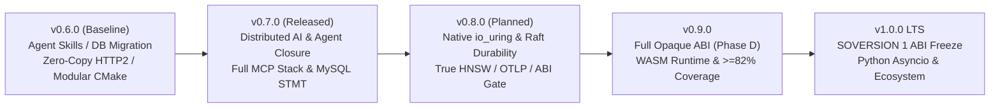

# csilk Roadmap (v0.7.0 → v1.0.0 LTS)

> **Baseline**: `0.7.0` | **Planned**: `2026-11-13` | **Target Milestone**: `v1.0.0 LTS`  
> [English](ROADMAP.md) | [中文](../../zh-CN/meta/ROADMAP.md)

---

## 1. Current Baseline & Gap Inventory (v0.7.0)

`v0.7.0` completed modular CMake Target DAG decoupling, native Anthropic Messages API (Claude) driver, Ollama streaming and tool calling parity, full-stack MCP Server endpoints (resources/prompts/ping/SSE), Raft WAL distributed command replication, clustered Skill Worker heartbeat tracking, three major relational databases (SQLite/PostgreSQL/MySQL `MYSQL_STMT`) with native prepared statements and migrations, live database container CI tests, and shutdown write drain with zero LSan suppressions.

A codebase audit shows the following remaining items on the road to `v1.0.0 LTS`:

| Area | Current State / Known Gap | Primary Files |
| :--- | :--- | :--- |
| **Raft Disk Durability** | `raft_wal.c` and `raft_snapshot.c` are in-memory index-advancing stubs rather than disk-persisted sequential log files, compaction, and multi-node election | `src/messaging/raft_wal.c`, `raft_snapshot.c`, `raft_consensus.c` |
| **Distributed Rate-Limit TTL** | Redis `INCR`+`EXPIRE` is non-atomic and `csilk_storage_driver_t` does not return remaining window TTL, forcing `ratelimit.c` to fall back to the full window for `Retry-After` | `src/drivers/db/redis_storage.c`, `src/middleware/ratelimit.c`, `sliding_ratelimit.c` |
| **Native io_uring Stability** | Native `CSILK_USE_URING=ON` hits `invalid-free` crashes in integration tests; CI defaults to `libuv + UV_USE_IO_URING=1` and `.gcovr` excludes `uring_vector.c` | `src/core/uring/`, `.github/workflows/ci.yml`, `.gcovr` |
| **True HNSW Graph Traversal** | `csilk_hnsw_insert` only chains layer-0 predecessors and `csilk_hnsw_search` scans only the first `k` nodes without sorting or multi-layer skip-graph search | `src/drivers/vector/vector_hnsw.c` |
| **OTLP Trace Closure** | `otlp_trace.c` uses a hardcoded demo `trace_id`; automatic HTTP → DB → AI/Tool child span propagation and async batch export are incomplete | `src/middleware/otlp_trace.c`, `otlp_exporter.c` |
| **WASM / WASI Sandbox** | Currently limited to magic-number checks and minimal host-import stubs without a bytecode execution engine (such as WAMR) | `src/core/plugin/wasm_plugin.c`, `wasm_wasi.c` |
| **Opaque ABI & Cross-Language Gate** | `include/csilk/` no longer exposes `ctx_types.h`; remaining work covers `CSILK_DEPRECATE_CTX_TYPES` test/example audit, automated C/Python ABI layout checks, and Phase D symbol/SOVERSION 1 freeze | `include/csilk/`, `cmake/libcsilk.map`, `python/csilk/lib.py` |

---

## 2. Release Progression Overview

---

## 3. Phased Milestones

### Phase 1: v0.7.0 — Distributed AI / Agent Closure & Protocol Completeness

**Objective**: Replace prototype placeholders in the AI and workflow subsystems with a production-ready local and clustered agent runtime.

1. **Remote Agent Skill Execution Closure (`src/workflow/skill.c`)**
   - Implement the worker-side `csilk.skill.invoke` subscriber: validate request → run bounded `csilk_skill_exec_local()` → publish `stdout` / `exit_code` / `truncated` to `csilk.skill.result`.
   - Implement non-blocking result collection on `csilk_async_op_t`, `idem`-key deduplication cache, and timeout-based failover retry on the caller side.
2. **Workflow Cluster State Machine (`src/workflow/wf_cluster_sm.c`)**
   - Replace in-memory placeholders with a WAL + `csilk_mq`-backed DAG execution state machine supporting crash recovery for long-running Agent and Human-in-the-Loop (HITL) nodes.
3. **Full-Stack MCP Support (`src/protocols/mcp/`)**
   - Upgrade `mcp_client.c` to parse remote `tools/list` JSON schemas and register live handlers into `csilk_tool_registry_t`, removing placeholder tools.
   - Complete `mcp_server.c` handlers for `resources/list`, `resources/read`, `prompts/list`, and `prompts/get`, removing `Method not implemented` responses.
   - Add **MCP over SSE / Streamable HTTP** transport alongside the existing stdio process pool under a unified transport interface.
4. **LLM Driver Parity & Native Anthropic Driver (`src/drivers/ai/`)**
   - Add a native **Anthropic Messages API** driver (streaming tool use, prompt-caching headers, token accounting) to pair natively with Anthropic-semantics Agent Skills.
   - Bring `ollama.c` to feature parity with `openai.c` for streamed `delta.tool_calls` reassembly and `csilk_ai_trace_t` throughput metrics.

**Exit Criteria**:
- Multi-node MQ integration test covering remote skill round-trip, idempotent replay, and timeout failover;
- MCP client/server test suite covering `tools/call`, `resources/read`, and SSE/HTTP transport.

---

### Phase 2: v0.8.0 — Storage / Consensus Durability, Kernel I/O Hardening & Observability

**Objective**: Replace in-memory persistence and vector stubs with durable/production implementations, resolve native `io_uring` crashes, close the end-to-end OTLP tracing loop, and enforce C/Python ABI layout checks.

1. **Phase 1: Native `io_uring` Stability & C/Python ABI Gate**
   - Fix `invalid-free` and cross-pool teardown bugs in `uring_close.c`, `uring_loop.c`, and `uring_tcp.c` under `-DCSILK_USE_URING=ON`; wire `uring_vector.c` (`writev`) and `uring_sqpoll.c` into live integration tests, re-enable native `CSILK_USE_URING=ON` in CI, and remove `uring_vector.c` from `.gcovr` exclusions.
   - Add automated C/Python shared-struct `sizeof` and `offsetof` verification tests to catch `python/csilk/lib.py` `ctypes.Structure` drift; add PEP 561 `.pyi` stubs and middleware integration coverage.
2. **Phase 2: Durable Raft WAL / Snapshots & Multi-Node Election (`src/messaging/`)**
   - Reuse `mq_wal.c` CRC32-framed binary log design for sequential Raft entries, configurable `ALWAYS`/`BATCH`/`INTERVAL_MS` `fsync` policies, and atomic `current_term`/`voted_for` persistence.
   - Implement atomic snapshot files (temp file + `fsync` + `rename`), log compaction, and follower `InstallSnapshot` recovery.
   - Complete randomized election timeouts and `RequestVote`/`AppendEntries` replication so `wf_cluster_sm.c` passes 3-node kill-and-restart failover tests.
3. **Phase 3: Atomic Distributed Rate Limiting & True HNSW Search (`src/drivers/`, `src/middleware/`)**
   - Upgrade `redis_storage.c` `incr` to atomic Lua (`INCR + conditional EXPIRE + PTTL`) and extend `csilk_storage_driver_t` to return remaining window TTL so `ratelimit.c` emits exact `Retry-After`; add optional shared backend support to `sliding_ratelimit.c`.
   - Upgrade `vector_hnsw.c` to true multi-layer random level assignment, `efConstruction` heuristic neighbor selection, greedy top-down + `efSearch` beam search Top-K heap ranking, and binary index persistence.
4. **Phase 4: End-to-End OTLP Child Spans & Async Export (`src/middleware/otlp_*.c`)**
   - Remove the hardcoded demo `trace_id` in `otlp_trace.c`; propagate active `trace_id` and `parent_span_id` across `HTTP Request → DB Query → AI / MCP / Tool Call` spans.
   - Add an async batched HTTP POST exporter thread with backpressure to `otlp_exporter.c` and surface live request waterfall traces in `/admin/apm`.
5. **Phase 5: Experimental HTTP/3 Transport, Fuzz Expansion & Quality Sprint**
   - Add opt-in `-DCSILK_ENABLE_HTTP3=ON` (default `OFF`) wiring `h3.c` to `ngtcp2`/OpenSSL QUIC API for UDP/QUIC handshakes and QPACK static-table header coding.
   - Add `fuzz_mcp` and `fuzz_sql_rewrite` libFuzzer targets, verify zero `CSILK_DEPRECATE_CTX_TYPES` warnings, and raise line coverage from **69%** toward **76%+**.

**Exit Criteria**:
- Both native `-DCSILK_USE_URING=ON` and `libuv + UV_USE_IO_URING=1` pass the full `ctest` suite in CI with zero `invalid-free` or leaks;
- 3-node Raft kill-and-restart failover test passes with zero committed-entry loss;
- Distributed Redis rate limiter returns accurate `Retry-After`; HNSW recall benchmark and C/Python ABI layout checks pass.

---

### Phase 3: v0.9.0 — Full Opaque ABI, Real WASM Runtime & Coverage Sprint

**Objective**: Complete the final breaking cleanups ahead of `v1.0.0` ABI freeze and raise verification coverage to release-candidate standards.

1. **Complete Opaque ABI Phases C & D ([ABI Opaque Roadmap](../design/abi-opaque-roadmap.md))**
   - **Phase C**: Migrate the remaining 30+ tests and examples from direct struct field access to `csilk_get_*` / `csilk_set_*` accessors and validate with `CSILK_DEPRECATE_CTX_TYPES`.
   - **Phase D**: Move `ctx_types.h` and internal layout headers from `include/csilk/` into `src/core/internal/`; tighten `cmake/libcsilk.map` so public headers expose 100% opaque handles only.
2. **Real WASM / WASI Plugin Runtime (`src/core/plugin/`)**
   - Integrate **WAMR (WebAssembly Micro Runtime)** behind an optional CMake flag (`-DCSILK_ENABLE_WAMR=ON`), replacing stubs in `wasm_plugin.c` and `wasm_wasi.c`.
   - Enforce per-invocation memory caps, instruction/fuel budgets (preventing runaway loops on worker threads), and zero-copy host ABI access to request headers/body/status with hot-reload support.
3. **End-to-End OTLP Tracing & 82%+ Line Coverage**
   - Implement the reserved hook in `src/middleware/otlp_trace.c` to propagate `traceparent` automatically across `HTTP Request` → `DB Query` → `AI / MCP / Tool` child spans and surface them in `/admin/apm`.
   - Add libFuzzer harnesses `fuzz_mcp` (JSON-RPC framing), `fuzz_h2` (HTTP/2 frame state machine), and `fuzz_sql_rewrite` (`?` → `$N` rewriting); raise total line coverage from **69%** to **≥ 82%**.

**Exit Criteria**:
- Header-only public API check verifies zero internal struct exposure under `include/csilk/`;
- Line coverage ≥ 82% and all 7 libFuzzer harnesses pass sustained 120s runs without ASAN/UBSAN findings.

---

### Phase 4: v1.0.0 LTS — ABI Freeze & Ecosystem Delivery

**Objective**: Deliver a Long-Term Support release with strict binary compatibility guarantees and turnkey packaging across C and Python ecosystems.

1. **SOVERSION 1 Freeze & Automated ABI Gate**
   - Bump `CSILK_VERSION` to `1.0.0`, lock `SOVERSION = 1`, and add a CI `libabigail` (`abidiff`) job comparing every PR against the `v1.0.0` ABI baseline.
2. **Package Manager Distribution**
   - Upstream `cmake/ports/csilk` to the official **vcpkg** registry; add a Conan Center recipe, a Homebrew Tap (`quintin-lee/tap/csilk`), and Debian/Ubuntu PPA packaging scripts.
3. **Python Bindings Modernization & PyPI Automation (`python/`)**
   - Ship PEP 561 `.pyi` type stubs for `mypy`/`pyright` and an `asyncio`-compatible bridge for Python handlers and AI workflows.
   - Wire PyPI Trusted Publishing (OIDC) into `.github/workflows/wheels.yml` so `v*` tags automatically publish `manylinux_2_34` (Linux x86_64) and `arm64` (macOS) wheels.
4. **Developer Tooling & v1.0 Benchmark Report**
   - Upgrade `scripts/csilkskel` and `scripts/generate-sdk.py` to scaffold JWT + DB migration + OpenAPI + AI Agent services and retry-capable TypeScript/Python client SDKs.
   - Publish a reproducible `v1.0` benchmark whitepaper comparing `csilk` (`libuv` and `io_uring`) against Nginx, Drogon, Go `net/http`, and Actix-web on 16-core hardware.

---

## 4. v0.8.0 Phase 1 Action Queue

| Priority | Phase | Action Item | Key Files |
| :--- | :--- | :--- | :--- |
| **P0** | Phase 1A | Diagnose and fix `CSILK_USE_URING=ON` integration test `invalid-free` and cross-pool frees; re-enable native uring in CI | `src/core/uring/uring_close.c`, `uring_loop.c`, `uring_tcp.c`, `.github/workflows/ci.yml` |
| **P0** | Phase 1B | Add automated C/Python shared-struct `sizeof` and `offsetof` ABI verification gate | `tests/`, `python/csilk/lib.py`, `python/tests/test_csilk.py` |
| **P0** | Phase 2 | Persist Raft WAL entries with CRC32 framing and `fsync`, atomic snapshots, and multi-node election | `src/messaging/raft_wal.c`, `raft_snapshot.c`, `raft_consensus.c` |
| **P1** | Phase 3 | Atomic Redis Lua `INCR/EXPIRE/PTTL`, accurate `Retry-After`, and true multi-layer `vector_hnsw.c` Top-K search | `src/drivers/db/redis_storage.c`, `src/middleware/ratelimit.c`, `src/drivers/vector/vector_hnsw.c` |
| **P1** | Phase 4 | Remove hardcoded demo `trace_id` in `otlp_trace.c` and wire end-to-end child spans with async OTLP export | `src/middleware/otlp_trace.c`, `otlp_exporter.c`, `src/app/admin.c` |
