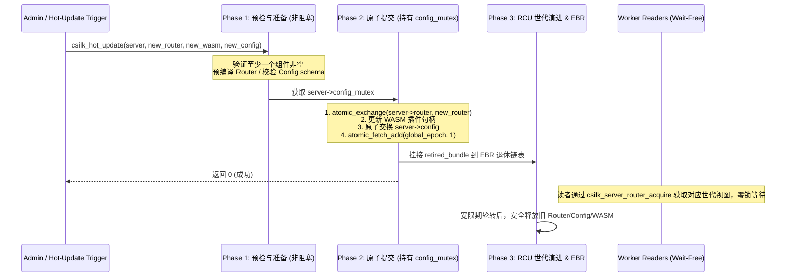

# csilk v1.2.0 自底向上架构硬化与遗留收敛设计规范 (Bottom-Up Architectural Hardening Design)

## 1. 概述与背景

在完成 Phase 6 方案一「自顶向下功能闭环」后，csilk 核心引擎已打通应用层、工作流、多智能体网格与 WAMR 沙箱插件。
为了确保底层引擎在万级高并发、生产级安全审计和复杂热更新场景下的绝对稳定性与轻量化，本项目启动**方案二：自底向上架构硬化与遗留收敛**。

根据 `docs/zh-CN/meta/ROADMAP-v1.2.md`、`docs/en/meta/CONNECTION-POOL-OPTIMIZATION.md` 以及 `docs/en/meta/HOT-UPDATE-PLAN.md`，本阶段聚焦于三大关键架构维度：
1. **安全与并发防御（Security & Concurrency Hardening）**：
   - 彻底清除代码库中残留的非重入函数 `strtok`（替换为 `strtok_r`）。
   - 实现高防 SSRF（Server-Side Request Forgery）内网与元数据探测过滤引擎，拦截针对 `127.0.0.0/8`、`10.0.0.0/8`、`172.16.0.0/12`、`192.168.0.0/16`、`169.254.0.0/16`（云厂商元数据服务）、IPv6 `::1`、`fe80::/10`、`fc00::/7`、以及 IPv4-mapped IPv6 的恶意回送。
2. **三组件原子热更新统一执行器（Triple-Component Atomic Hot-Update Engine）**：
   - 将原先彼此割裂的 Router RCU Swap、WASM 重载与 Config 重载，统合为具备完整事务性保障的 `csilk_hot_update` 执行器。
   - 采用「无锁预检校验 → 持锁原子世代切换 (RCU/EBR) → 宽限期旧资源安全释放」的三阶段模型。
3. **高并发连接池与内存模型极简优化（Extreme Connection Pool RSS Optimization）**：
   - 落地 **延迟 Arena 分配（Lazy Arena Allocation）** 与 **Keep-Alive 空闲自动归还** 机制。
   - 空闲 Keep-Alive 连接在等待下一个请求期间不占用大块 Arena 资源，将 10K Keep-Alive 连接的 RSS 降低 70% 以上，稳健达成 `< 1.5MB RSS / 10K Keep-Alive` 生产级目标。

---

## 2. 架构设计与关键机制

### 2.1 模块 A：安全加固与 SSRF 防护引擎

#### 2.1.1 消除非线程安全函数
- 在 `src/drivers/ai/llama.c` 的流式 chunk 分词路径中，将 `strtok(copy, " ")` 全面升级为带上下文指针的 `strtok_r(copy, " ", &saveptr)`，消除多 worker 线程并发调用 LLM 驱动时的分词状态冲突。

#### 2.1.2 SSRF 防御机制 (`csilk_security_url_is_ssrf_safe`)
在 `include/csilk/core/security.h` 和 `src/core/primitives/ssrf.c` 中实现：
- IP 地址范围检查：
  - IPv4:
    - `0.0.0.0/8` (This network)
    - `10.0.0.0/8` (Private Class A)
    - `127.0.0.0/8` (Loopback)
    - `169.254.0.0/16` (Link-Local / Cloud Metadata: AWS/GCP/Azure)
    - `172.16.0.0/12` (Private Class B)
    - `192.168.0.0/16` (Private Class C)
    - `255.255.255.255/32` (Broadcast)
  - IPv6:
    - `::` (Unspecified)
    - `::1` (Loopback)
    - `::ffff:0:0/96` (IPv4-mapped IPv6，自动解包后套用 IPv4 规则)
    - `fe80::/10` (Link-Local)
    - `fc00::/7` (Unique Local Address, ULA)
- URL 解析与 Host 验证：
  - 支持 `http://` 与 `https://` scheme 验证。
  - 解析 host（IPv4 字面量、IPv6 字面量 `[...]` 或域名，支持提取端口）。
  - 若输入为 IP 字面量，直接执行 CIDR 判定；若解析为私有/内网/保留地址且 `allow_private == false`，则判定不安全。
  - 导出 API：
    ```c
    bool csilk_security_is_private_ip(const char* ip_str);
    bool csilk_security_url_is_ssrf_safe(const char* url, bool allow_private);
    ```

---

### 2.2 模块 B：三组件原子热更新统一执行器 (`csilk_hot_update`)

#### 2.2.1 三阶段原子更新流程



#### 2.2.2 接口定义 (`include/csilk/core/server/hot_reload.h`)

```c
typedef struct {
    csilk_router_t*        router;
    void*                  wasm_handle;
    const char*            tmp_wasm_path;
    csilk_server_config_t* config;
} csilk_hot_update_bundle_t;

int csilk_hot_update(csilk_server_t* server,
                     csilk_router_t* new_router,
                     void*           new_wasm_handle,
                     const char*     new_wasm_tmp_path,
                     csilk_server_config_t* new_config);
```

---

### 2.3 模块 C：连接池与内存模型极简优化 (Lazy Arena)

#### 2.3.1 延迟分配与生命周期回收

- **现有痛点**：在 `connection_io.c:127` 中，一旦 TCP 连接建立，无论客户端是否发送数据，均立即从 worker pool 获取 `csilk_arena_t`（预先占用 4KB/16KB 内存 chunk）。当维持 10K Keep-Alive 连接时，产生极大无谓 RSS 占用。
- **优化方案**：
  1. `on_connection` 阶段：初始化连接句柄与解析器，但将 `client->ctx.arena` 置为 `NULL`。
  2. 触发首次读取（`on_read`）或进入 HTTP 解析阶段时：通过 `_csilk_ensure_client_arena(client)` 按需从 `pool_get_arena(wp)` 获取 arena。
  3. 请求完成（`_csilk_send_response` 写入完成 / `on_write_done`）：若连接复用进入 Keep-Alive 等待，重置 arena 并调用 `pool_put_arena(wp, client->ctx.arena)` 将其归还池中，使空闲连接在等待期 RSS 压降至最小。
  4. 连接关闭（`connection_close.c`）：若 arena 仍持有，安全归还。

---

## 3. ABI 兼容性与代码规范

- **SOVERSION 1 兼容性**：新增公共函数必须统一使用 `csilk_*` 前缀，严禁暴露内部辅助符号至动态符号表。
- **声明顺序规范**：严格遵循 `#include` 与全局/文件静态变量置顶规范。
- **LLVM 18 clang-format**：100% 格式对齐，`cmake --build build --target check-format` 零警告。
