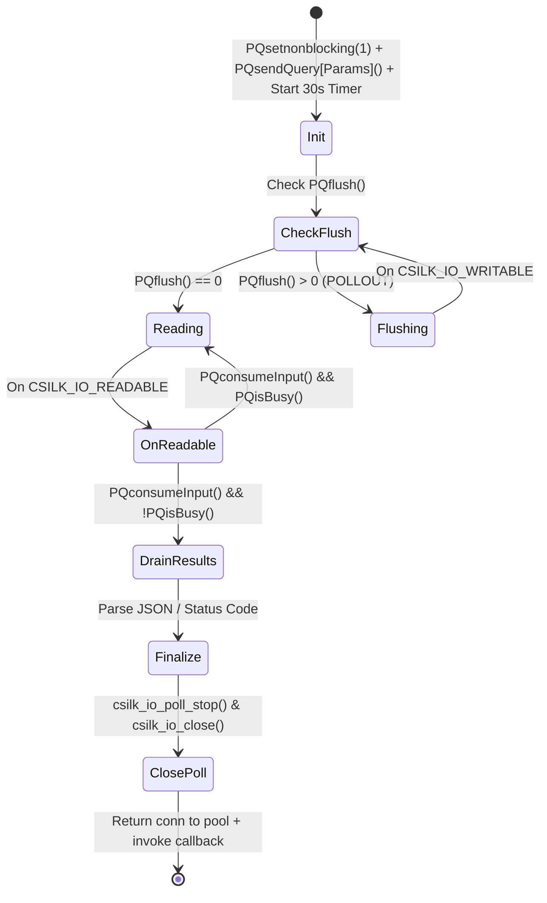

# Technical Specification: Event-Loop-Driven Non-Blocking Asynchronous Database Driver Integration

- **Status**: Approved by User
- **Date**: 2026-11-24
- **Target Release**: csilk v1.2
- **Author**: Antigravity & User

---

## 1. Intent & Context

`csilk` v1.2 introduced asynchronous database query signatures (`csilk_db_set_nonblocking`, `csilk_db_query_async`, `csilk_db_exec_async`). However, the initial driver implementations in `src/drivers/db/postgres.c` and `src/drivers/db/mysql.c` were transitional stubs: they suppressed the target event loop with `(void)loop;` and ran a synchronous `while (...) poll(&pfd, 1, 100);` loop on the calling thread.

In high-concurrency HTTP handler workflows, executing `csilk_db_query_async()` on a worker event loop blocks that worker thread for the entire duration of the database round-trip (often 10ms - 100ms+), stalling all other HTTP requests assigned to that worker.

This specification details the architectural convergence to transform `postgres.c` and `mysql.c` into **true, event-loop-driven asynchronous state machines** that attach database sockets directly to `csilk_io_loop_t`.

---

## 2. Goals, Non-Goals & Anti-Goals

### 2.1 Goals
1. **Cross-Backend Socket Polling Abstraction (`csilk_io_poll_t`)**:
   - Provide standard `csilk_io_poll_t` macros and helpers in `include/csilk/core/sys_io.h` for both `libuv` (`uv_poll_t`) and `io_uring` (`io_uring_prep_poll_add`).
   - Support `CSILK_IO_READABLE`, `CSILK_IO_WRITABLE`, and `CSILK_IO_DISCONNECT` events.
2. **PostgreSQL Event-Driven Driver (`postgres.c`)**:
   - Zero worker thread blocking.
   - Socket write flush phase: driven by `CSILK_IO_WRITABLE` until `PQflush() == 0`.
   - Socket read response phase: driven by `CSILK_IO_READABLE` with `PQconsumeInput()` until `!PQisBusy()`.
   - Result extraction, connection release back to pool, and callback dispatch strictly on `loop`.
3. **MySQL Event-Driven Driver (`mysql.c`)**:
   - For MariaDB non-blocking client (`mysql_real_query_start` / `cont`, `mysql_store_result_start` / `cont`), drive execution asynchronously via `csilk_io_poll_t` mapped to `MYSQL_WAIT_READ` and `MYSQL_WAIT_WRITE`.
   - For parameterized queries (`params != NULL`), perform client-side SQL parameter interpolation with `mysql_real_escape_string_quote` to eliminate SQL injection without requiring a complex 4-phase prepared statement state machine.
   - For standard Oracle MySQL clients lacking non-blocking socket APIs, seamlessly fall back to `csilk_io_queue_work` offload so the worker loop is never blocked and `csilk_db_set_nonblocking(pool, 1)` succeeds.
4. **Lifecycle, Pool Concurrency & Clean Connection Return**:
   - Detach async connection leases from thread ID so multiple concurrent async queries on the same worker thread acquire separate connection instances.
   - If the pool is exhausted, enqueue the async query in a FIFO pending queue with a default 5000ms acquire timeout; upon connection return, immediately pop and dispatch the next pending query.
   - Clean handle tear-down without leaking poll handles or open memory.
   - Automatic query timeout (default 30s) and poisoned/broken connection sanitization (destroy & reconnect rather than returning dirty connections to the pool).
5. **Quality & ABI Compatibility**:
   - Maintain 100% backward ABI compatibility (`SOVERSION 1`).
   - Clean compilation under GCC 13+ and Clang 19+ in C23 mode.

### 2.2 Non-Goals
- Modifying synchronous APIs (`csilk_db_query`, `csilk_db_exec`).
- Modifying in-process drivers without sockets (e.g. SQLite, which has no socket; SQLite async queries continue to use `csilk_io_queue_work`).

### 2.3 Anti-Goals
- Spawning a dedicated thread per asynchronous database query.
- Using blocking `poll()` or `select()` inside `postgres_query_async` or `mysql_drv_query_async`.
- Calling raw `uv_*` or `pthread_*` directly in driver source code.

---

## 3. Alternative Approaches Considered

### Approach A: Thread-Pool Offloading (`csilk_io_queue_work`) for all queries
- **How it works**: Treat all DB operations as blocking worker tasks and queue them onto libuv/io_uring's internal thread pool (`csilk_io_queue_work`).
- **Pros**: Easy to implement; no need to touch libpq or MySQL state machines.
- **Cons**: Severe scalability ceiling. The default thread pool size is 4 (or 16); under 1,000 concurrent DB queries, 990 queries queue up waiting for thread worker slots, destroying throughput and inflating P99 latency.
- **Verdict**: Rejected for PostgreSQL and non-blocking MySQL. Only acceptable as fallback when driver library lacks non-blocking socket APIs.

### Approach B: Single-Thread Reactor with Epoll/Kqueue Directly
- **How it works**: Bypass libuv/io_uring and write Linux `epoll` or macOS `kqueue` directly inside the database drivers.
- **Pros**: Direct kernel syscalls.
- **Cons**: Violates project guideline ("Never call raw OS reactor/pthread directly"). Breaks cross-platform macOS/Linux abstraction and clashes with the worker's active `csilk_io_loop_t`.
- **Verdict**: Rejected.

### Approach C: Unified Event-Loop Socket Polling (`csilk_io_poll_t`) State Machine (Selected)
- **How it works**: Introduce a minimal, zero-cost `csilk_io_poll_t` abstraction in `sys_io.h`. In `postgres.c` and `mysql.c`, allocate an async query context, attach `PQsocket` / MySQL socket to the target `loop`, and transition through write/read states via poll callbacks.
- **Pros**:
  - Genuinely non-blocking. Single worker thread can manage thousands of concurrent in-flight DB queries.
  - Zero extra OS threads required.
  - Seamlessly integrates with csilk's existing worker loops and context deferral.
- **Cons**: Requires carefully managing state transitions (flushing vs reading) and handle closing before returning the connection to the pool.
- **Verdict**: Chosen.

---

## 4. Detailed Design

### 4.1 Cross-Backend Polling Abstraction (`include/csilk/core/sys_io.h`)

We define the polling types and functions:

```c
#ifndef CSILK_USE_URING
/* libuv backend */
typedef uv_poll_t csilk_io_poll_t;
typedef void (*csilk_io_poll_cb)(csilk_io_poll_t* handle, int status, int events);

#define CSILK_IO_READABLE    UV_READABLE
#define CSILK_IO_WRITABLE    UV_WRITABLE
#define CSILK_IO_DISCONNECT  UV_DISCONNECT

static inline int
csilk_io_poll_init(csilk_io_loop_t* loop, csilk_io_poll_t* handle, int fd)
{
    return uv_poll_init(loop, handle, fd);
}

static inline int
csilk_io_poll_init_socket(csilk_io_loop_t* loop, csilk_io_poll_t* handle, csilk_io_os_sock_t socket)
{
    return uv_poll_init_socket(loop, handle, socket);
}

static inline int
csilk_io_poll_start(csilk_io_poll_t* handle, int events, csilk_io_poll_cb cb)
{
    return uv_poll_start(handle, events, (uv_poll_cb)cb);
}

static inline int
csilk_io_poll_stop(csilk_io_poll_t* handle)
{
    return uv_poll_stop(handle);
}
#else
/* io_uring backend */
typedef struct csilk_io_poll_s csilk_io_poll_t;
typedef void (*csilk_io_poll_cb)(csilk_io_poll_t* handle, int status, int events);

#define CSILK_IO_READABLE    0x01
#define CSILK_IO_WRITABLE    0x02
#define CSILK_IO_DISCONNECT  0x04

struct csilk_io_poll_s {
    CSILK_IO_HANDLE_FIELDS
    csilk_io_poll_cb cb;
    int              events;
};

int csilk_io_poll_init(csilk_io_loop_t* loop, csilk_io_poll_t* handle, int fd);
int csilk_io_poll_init_socket(csilk_io_loop_t* loop, csilk_io_poll_t* handle, csilk_io_os_sock_t socket);
int csilk_io_poll_start(csilk_io_poll_t* handle, int events, csilk_io_poll_cb cb);
int csilk_io_poll_stop(csilk_io_poll_t* handle);
#endif
```

### 4.2 Connection Pool Async Leases & FIFO Pending Queue (`src/drivers/db/db.c`)

In `csilk_db_pool_t`:
1. **Async Leases**:
   - Differentiate synchronous re-entrant leases (keyed by `csilk_thread_self()`) from asynchronous query leases (allocated an independent connection slot marked with an `is_async_lease` flag).
   - This allows a single worker thread to hold $N$ concurrent connections for $N$ concurrent asynchronous queries without collision.
2. **FIFO Pending Queue**:
   - When all connections in the pool are currently leased (`active == max`), incoming asynchronous queries are not rejected immediately with `CSILK_DB_ERR_CONN`. Instead, an entry is queued to `pool->async_wait_head` / `tail`.
   - When any connection is returned via `csilk_db_pool_put()`, the pool pops the next pending query from the FIFO queue and immediately dispatches it on the connection.
   - An acquire timer (default 5000ms) cancels the pending query with `CSILK_DB_ERR_BUSY` if the queue does not advance within the timeout.

### 4.3 PostgreSQL Async State Machine (`src/drivers/db/postgres.c`)

Each asynchronous query or exec allocates a lightweight heap context:

```c
typedef enum {
    PG_ASYNC_STATE_FLUSHING, /* Waiting for PQflush() == 0 */
    PG_ASYNC_STATE_READING,  /* Waiting for !PQisBusy() */
    PG_ASYNC_STATE_CLOSING   /* Closing poll handle */
} pg_async_state_e;

typedef struct {
    csilk_db_pool_t*        pool;
    void*                   raw_conn;
    pg_conn_t*              conn;
    csilk_io_loop_t*        loop;
    csilk_io_poll_t         poll;
    csilk_io_timer_t        timer;
    pg_async_state_e        state;
    bool                    is_query; /* true for query_async, false for exec_async */
    csilk_db_query_async_cb query_cb;
    csilk_db_exec_async_cb  exec_cb;
    void*                   user_data;
} pg_async_op_ctx_t;
```

#### State Transition Flow:


1. **Submission**:
   - `PQsetnonblocking(conn->db, 1)`.
   - Submit query via `PQsendQueryParams` or `PQsendQuery`.
   - Start 30s query timeout timer (`csilk_io_timer_start`).
   - Call `PQflush(conn->db)`:
     - If `flush_rc == 0`: all sent; register poll for `CSILK_IO_READABLE`.
     - If `flush_rc > 0`: partial write; register poll for `CSILK_IO_WRITABLE`.
     - If `flush_rc < 0`: socket error; flag connection as broken and fail.
2. **Event Callback**:
   - If `state == PG_ASYNC_STATE_FLUSHING`:
     - Call `PQflush(conn->db)`.
     - If `0`: switch poll to `CSILK_IO_READABLE`, update state to `PG_ASYNC_STATE_READING`.
     - If `< 0`: failure; initiate shutdown and discard connection.
   - If `state == PG_ASYNC_STATE_READING`:
     - If `PQconsumeInput(conn->db) == 0`: server disconnected; error out, destroy connection.
     - If `!PQisBusy(conn->db)`:
       - Query complete! Drain all `PQgetResult()`.
       - Stop timeout timer (`csilk_io_timer_stop`).
       - Convert `PGresult` into `csilk_json_t*` (for queries) or row count (for exec).
       - Stop poll handle via `csilk_io_poll_stop()`.
       - Close poll handle via `csilk_io_close()`.
       - In poll close callback: release connection back via `csilk_db_pool_put(pool, raw_conn)`, fire user callback `cb(result, err, user_data)`, and free the context.

### 4.4 MySQL Async State Machine (`src/drivers/db/mysql.c`)

1. **Parameter Handling (Option 2-A)**:
   - For queries with parameters (`params != NULL`), interpolate and escape each `?` placeholder using `mysql_real_escape_string_quote(conn->db, ...)` into an allocated SQL buffer.
   - Execute the sanitized query via `mysql_real_query_start`.
2. **MariaDB Non-Blocking Socket Loop**:
   - Call `mysql_real_query_start(&ret, conn->db, full_sql, len)`.
   - If `wait_status != 0`:
     - Map `MYSQL_WAIT_READ` -> `CSILK_IO_READABLE`, `MYSQL_WAIT_WRITE` -> `CSILK_IO_WRITABLE`.
     - Register `csilk_io_poll_t`.
     - On poll event, invoke `mysql_real_query_cont(&ret, conn->db, status)`.
     - Repeat until `wait_status == 0`.
     - Then call `mysql_store_result_start(&res, conn->db)` and `cont` similarly.
3. **Oracle MySQL Fallback**:
   - When compiled with standard MySQL lacking non-blocking socket APIs, `mysql_drv_set_nonblocking(pool, 1)` succeeds (`return 0`) and delegates `query_async` / `exec_async` to `csilk_io_queue_work` on the target loop, ensuring caller callbacks fire without error.

### 4.5 Worker Loop Resolution & Context Accessor
- When `loop == NULL`:
  - Query worker TLS `_csilk_get_current_worker_pool()`. If the caller is on an active worker thread, use `&wp->loop`.
  - If caller is on another thread (CLI or test runner), fall back to `csilk_io_default_loop()`.
- Expose `csilk_io_loop_t* csilk_ctx_get_loop(const csilk_ctx_t* ctx)` in `include/csilk/core/ctx/context.h`.

---

## 5. Verification Plan

### 5.1 Unit & Driver Tests
1. **`test_db_nonblocking`**:
   - Verify `csilk_io_poll_t` registration on loop.
   - Verify that running an asynchronous query does not block the caller thread.
   - Verify callback execution inside the event loop iteration.
   - Verify FIFO queue dispatch when pool size is smaller than concurrency.
2. **Real PostgreSQL Service Test (`test_db_postgres.c`)**:
   - Add test case executing 100 concurrent asynchronous queries (`csilk_db_query_async`) against the live PostgreSQL container on Ubuntu runner.
   - Verify all 100 queries complete without packet loss, connection leaks, or thread deadlocks.
3. **Real MySQL Service Test (`test_db_mysql.c`)**:
   - Execute parameterized asynchronous queries (`csilk_db_query_async`) against the live MySQL container.
   - Verify non-blocking execution and result JSON integrity.

### 5.2 Sanitizer & Concurrency Gates
- **TSAN (ThreadSanitizer)**: Verify 0 data races between connection pool release, event loop dispatch, and client callback.
- **ASAN / LSAN**: Verify 0 memory leaks across all allocated async contexts and poll handles.
- **ABI Compatibility**: Run `./scripts/check_abi_compatibility.sh` to ensure no public ABI breakages.
