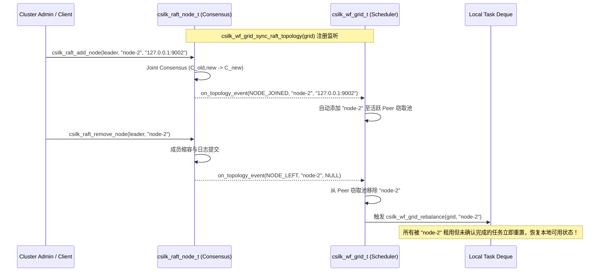

# 分布式任务网格与 Raft 集群拓扑自愈闭环设计规范 (Grid ↔ Raft Auto-Topology Design)

## 1. 概述与背景

在 csilk v1.2 体系中，去中心化 Multi-Agent 任务网格（`csilk_wf_grid`）与 Raft 联合一致性分布式共识（Joint Consensus）已分别作为核心底座落地：
- **`csilk_wf_grid`**：实现了双端工作窃取队列（Local LIFO / Remote FIFO）、按内存地址排序的无死锁加锁协议（`_lock_grid_pair`）与 5 秒租约仲裁机制；
- **`csilk_raft`**：实现了两阶段原子成员变更（$C_{old,new} \to C_{new}$）、双多数派裁决（Dual-Quorum Consensus）以及动态节点热增删（`csilk_raft_add_node` / `csilk_raft_remove_node`）。

此前，虽然 `csilk_wf_grid_new(node_id, raft, mq)` 接收了 `raft` 句柄，但网格内部对集群成员的变动仍处于被动割裂状态。当集群发生动态扩容、节点缩容或宕机离线时，网格无法自动感知对端状态，依赖上层繁琐的手动编排。

本项目目标为：**将 Multi-Agent Grid 与 Raft 状态机打通事件驱动的闭环联动，构建零配置感知、拓扑自愈的去中心化工作流调度集群**。

---

## 2. 目标、非目标与反目标

### 2.1 目标 (Goals)
1. **拓扑动态自发现**：当 Raft 集群加入新节点（如调用 `csilk_raft_add_node` 或初始建立拓扑）时，Grid 自动将对端加入 Peer 窃取池。
2. **故障与下线自动重平衡**：当 Raft 节点缩容下线（`csilk_raft_remove_node`）或失联退出时，Grid 实时感知并自动触发 `csilk_wf_grid_rebalance`，回收被窃取但在下线节点未完成的任务切片。
3. **混合双保险防护**：兼备事件驱动（毫秒级感知）与单调时钟租约兜底（5 秒超时自动解冻），防止网络半脑裂导致任务永久冻结。
4. **ABI 纯净兼容**：保持 SOVERSION 1 动态库导出符号兼容，新增公共 API 全部使用 `csilk_*` 前缀。

### 2.2 非目标 (Non-Goals)
1. 不替换 Raft 现有的日志复制与状态机提交主干；
2. 不强制要求每一个单一 Agent 任务切片都同步写入 Raft WAL（维持高吞吐与 P99 ≤ 5ms 线速要求）。

### 2.3 反目标 (Anti-Goals)
1. 严禁在 Raft 心跳或共识主循环中引入长时间阻塞式任务等待；
2. 严禁在网格加锁与 Raft 节点加锁之间形成交叉死锁（遵循严格的单向依赖：Grid 监听 Raft，Raft 内部不持有 Grid 锁）。

---

## 3. 备选方案对比与决策 (Approaches)

在方案设计初期，评估了三种联动路径：

| 方案 | 机制描述 | 优势 | 劣势与权衡 | 裁决结论 |
| :--- | :--- | :--- | :--- | :--- |
| **方案 A：周期性轮询与被动对齐** | 在工作流窃取或定时器中调用 `csilk_raft_get_membership` 对比集群视图差异。 | 零侵入，逻辑简单。 | 存在轮询延迟，节点下线无法实时感知，重平衡滞后。 | ❌ 放弃 |
| **方案 B：纯事件驱动拓扑回调** | Raft 在两阶段提交完成时通过回调通知 Grid 增删节点。 | 毫秒级零延迟响应。 | 遇到网络分区或事件丢失时，缺少第二道自愈防线。 | ❌ 放弃 |
| **方案 C：事件驱动 + 租约双保险混合机制** | **以事件驱动为主（主动路径）**，结合 **5 秒单调时钟租约兜底（被动路径）**。 | 兼顾毫秒级极速拓扑响应与高可用容灾兜底。 | 需向 Raft 注册轻量级拓扑监听器（约 20 行）。 | **✅ 采纳（用户选定）** |

---

## 4. 详细架构与接口设计

### 4.1 核心数据流与时序



### 4.2 Raft 层：拓扑监听器抽象 (`include/csilk/messaging/raft.h`)

```c
/**
 * @brief Raft 集群拓扑与成员变更事件类型。
 */
typedef enum {
    CSILK_RAFT_TOPOLOGY_NODE_JOINED = 1, /**< 新节点加入集群 (C_new) */
    CSILK_RAFT_TOPOLOGY_NODE_LEFT   = 2, /**< 节点从集群中移除 */
    CSILK_RAFT_TOPOLOGY_CONF_STABLE = 3, /**< 集群成员变更完成，恢复稳定状态 */
} csilk_raft_topology_event_t;

/**
 * @brief 拓扑变更事件回调函数签名。
 */
typedef void (*csilk_raft_topology_cb_t)(csilk_raft_node_t*          node,
                                         csilk_raft_topology_event_t event,
                                         const char*                 peer_id,
                                         const char*                 peer_addr,
                                         void*                       user_data);

/**
 * @brief 注册 Raft 集群拓扑事件监听器。
 *
 * @param node Raft 节点实例。
 * @param cb 回调函数（传 NULL 取消注册）。
 * @param user_data 传递给回调的用户上下文指针。
 * @return 0 成功，-1 参数非法。
 */
int csilk_raft_set_topology_cb(csilk_raft_node_t*       node,
                               csilk_raft_topology_cb_t cb,
                               void*                    user_data);
```

### 4.3 Grid 层：自动同步与拓扑状态接口 (`include/csilk/app/wf_grid.h`)

```c
/**
 * @brief 将任务网格与底层绑定的 Raft 节点拓扑自动挂载联动。
 *
 * 自动拉取当前存量成员，并注册动态事件监听；当集群拓扑发生扩缩容或故障时，
 * 自动维护 Peer 列表并触发任务重平衡。
 *
 * @param grid 网格节点句柄。
 * @return 0 成功，-1 若 grid 为空或未绑定 raft。
 */
int csilk_wf_grid_sync_raft_topology(csilk_wf_grid_t* grid);

/**
 * @brief 查询当前网格跟踪的活跃 Peer 节点总数。
 *
 * @param grid 网格节点句柄。
 * @return Peer 节点数量。
 */
size_t csilk_wf_grid_peer_count(const csilk_wf_grid_t* grid);

/**
 * @brief 检查指定 node_id 是否在当前网格 Peer 列表中。
 *
 * @param grid 网格节点句柄。
 * @param peer_id 节点标识字符串。
 * @return true 存在，false 不存在。
 */
bool csilk_wf_grid_has_peer(const csilk_wf_grid_t* grid, const char* peer_id);
```

---

## 5. 质量门禁与验证要求

1. **死锁防护**：
   - Raft 触发回调时，先释放内部 `node->mutex`，或在通知前拷贝轻量事件数据，避免在持有 Raft 锁的同时请求 Grid 锁；
   - Grid 内部处理拓扑变更时使用自身的 `grid->mutex`。
2. **测试验证矩阵**：
   - 在 `tests/workflow/test_wf_grid_raft.c` 中构造集群动态伸缩测试：
     - 测试 1：初始 3 节点集群，Grid 绑定后自动发现全部 Peer；
     - 测试 2：调用 `csilk_raft_add_node`，验证各节点网格毫秒级自发现新 Peer；
     - 测试 3：从 Node 1 窃取任务至 Node 2；调用 `csilk_raft_remove_node` 下线 Node 2，验证 Node 1 自动感知并秒级重平衡回归本地队列；
     - 测试 4：网络隔离测试，验证 5 秒单调时钟租约超时自愈。
3. **规范要求**：
   - 全工程符合 LLVM 18 clang-format 规范；
   - ABI 稳定性验证 0 告警，SOVERSION 1 完全兼容。
