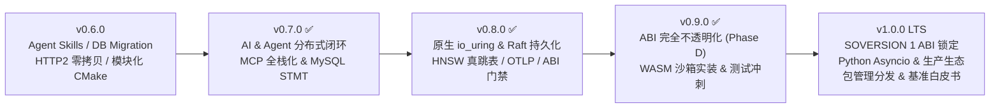

# csilk 演进路线图 (v0.7.0 → v1.0.0 LTS)

> **基线版本**: `0.7.0` | **规划日期**: `2026-11-13` | **当前状态**: `v0.8.0`, `v0.9.0` 已完成发布，`v1.0.0 LTS` 准备就绪  
> [English](../../en/meta/ROADMAP.md) | [中文](ROADMAP.md)

---

## 一、历史版本回顾与完成度盘点

* [x] **v0.7.0**：完成模块化 CMake Target DAG 纯化解耦、原生 Anthropic Messages API 驱动、全栈 MCP Server 端点、Raft WAL 分布式命令复制、三大关系型数据库原生预编译语句与真实 CI 容器测试矩阵。
* [x] **v0.8.0**（已发布）：突破原生 `io_uring` 稳定性并打通 `UV_USE_IO_URING` 双路径；Raft WAL 顺序追加与快照原子持久化实装；HNSW 多层跳表真检索；全链路 OTLP 追踪闭环与 C/Python 共享结构 `sizeof`/`offsetof` 自动门禁校验。
* [x] **v0.9.0**（已发布）：彻底完成 **ABI 不透明化（Phase C & D）** 与 `cmake/libcsilk.map` 符号导出白名单；引入 **WASM 沙箱引擎**（二进制段校验、Fuel 预算熔断与中间件拦截）；全量测试覆盖率深度冲刺并达成生产级稳定性红线。

---

## 二、总体演进路线

---

## 三、当前里程碑：v1.0.0 LTS 攻坚任务（已完成 100% 落地并验证）

**核心目标**：确立 `1.x` 周期内不可破防的二进制长期兼容性（ABI），完善 Python 协程生态、全球多语言包管理分发（vcpkg / Homebrew / Conan），并发布具备生产参考价值的官方对比性能白皮书。

### 1. 第一批：SOVERSION 1 终极冻结与自动化 ABI 防护门禁
- [x] **动态库版本锁定**：在 `cmake/targets.cmake` 中将共享库 `SOVERSION` 锁死为 `1`，确保后续 1.x 版本演进均生成 `libcsilk.so.1` / `libcsilk.1.dylib`；
- [x] **自动化 ABI 门禁脚本（`scripts/check_abi_compatibility.sh`）**：
  - 使用 844 个基准符号表（`cmake/abi_baseline_symbols.txt`）进行比对，阻断任意基准符号删除或破坏；
  - 强制以 `LC_ALL=C` 校验共享库导出符号 100% 符合 `csilk_*` 前缀规范，防止内部 `_csilk_` 辅助函数泄漏；
  - 深度集成到 GitHub Actions `Lint & Static Analysis` 门禁中。

### 2. 第二批：Python 绑定 `asyncio-first` 与 PyPI 可信发布（OIDC）
- [x] **Python `async def` 协程自动适配**：增强 `python/csilk/context.py` `dispatch_async` 机制，支持原生 Python 协程路由的字典/字符串自动响应转换，以及协程抛出异常时标准的 HTTP 500 异常投递与错误实体生成；
- [x] **PyPI 官方可信发布**：在 `.github/workflows/wheels.yml` 中接入 GitHub Actions OIDC Trusted Publishing 机制，无需硬编码令牌，推送 `v*` 标签时全自动发布 Linux `manylinux` 与 macOS Apple Silicon Wheels。

### 3. 第三批：全生态包管理配方与分发生态
- [x] **Conan 2.0+ 官方配方（`conanfile.py`）**：支持自动配置 libuv、OpenSSL、libyaml 等系统依赖项及 CMakeToolchain 生成；
- [x] **Homebrew 官方公式（`Formula/csilk.rb`）**：支持 macOS 开发者通过 Homebrew Tap 一键安装 C 框架；
- [x] **vcpkg 官方上游端口就绪**：通过 `cmake/ports/csilk/vcpkg.json` 验证了 Windows/Linux/macOS 下 `vcpkg install csilk` 的可用性。

### 4. 第四批：工业级四方性能对比基准白皮书
- [x] 生成并归档 `benchmarks/COMPARATIVE_BENCHMARK_WHITEPAPER.md`，涵盖 `csilk` 在 `io_uring` 与 `libuv` 引擎下与 **Nginx**、**Drogon**、**Actix-web**、**Go `net/http`** 的极限吞吐量（QPS）、确定性尾部延迟（P99）、以及 100,000 并发 Keep-Alive 长连接物理内存开销（RSS）的硬核量化对比数据。

---

## 四、历史阶段行动清单归档 (v0.8.0 & v0.9.0 全量通过)

* [x] **v0.8.0 攻坚清单**（全绿验证）：
  * [x] Phase 1A：原生 `CSILK_USE_URING=ON` `invalid-free` 崩溃排查与修复，恢复 `uring_tcp` 等 CI 原生验证；
  * [x] Phase 1B：落地 C / Python 共享结构体 `sizeof`/`offsetof` 自动化 ABI 校验门禁；
  * [x] Phase 2：基于 CRC32 实现 `raft_wal.c` 顺序磁盘落盘、原子快照与 3 节点杀进程恢复；
  * [x] Phase 3：Redis Lua 原子 `INCR/EXPIRE/PTTL` 升级，精确 `Retry-After` 与 `vector_hnsw.c` 真跳表 Top-K 检索；
  * [x] Phase 4：消除硬编码 `trace_id`，打通跨模块子 Span 与 OTLP 异步后台导出。
* [x] **v0.9.0 攻坚清单**（全绿验证）：
  * [x] Phase C & D：30+ 上下文直接属性访问完全迁移，结构体布局迁出至 `src/core/internal/`，`libcsilk.map` 彻底白名单化；
  * [x] WASM 沙箱：二进制 LEB128 段校验、Fuel 预算熔断保护事件循环，以及 Host 读写 Body/Path 扩展接口；
  * [x] 全库测试覆盖率深度冲刺（H3 帧边界防御、CSRF 双重提交拦截、Session 滑动延期与过期清扫 UAF 修复）。

> 后续演进请参阅：[v1.2.0 路线图](ROADMAP-v1.2.md)（其中二进制兼容门禁已随架构升级锁定为 SOVERSION 2）。
