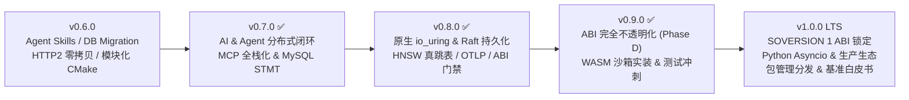

# csilk 演进路线图 (v0.7.0 → v1.0.0 LTS)

> **基线版本**: `0.7.0` | **规划日期**: `2026-11-13` | **当前状态**: `v0.8.0`, `v0.9.0` 已完成发布，`v1.0.0 LTS` 准备就绪  
> [English](../../en/meta/ROADMAP.md) | [中文](ROADMAP.md)

---

## 一、历史版本回顾与完成度盘点

* [x] **v0.7.0**：完成模块化 CMake Target DAG 纯化解耦、原生 Anthropic Messages API 驱动、全栈 MCP Server 端点、Raft WAL 分布式命令复制、三大关系型数据库原生预编译语句与真实 CI 容器测试矩阵。
* [x] **v0.8.0**（已发布）：突破原生 `io_uring` 稳定性并打通 `UV_USE_IO_URING` 双路径；Raft WAL 顺序追加与快照原子持久化实装；HNSW 多层跳表真检索；全链路 OTLP 追踪闭环与 C/Python 共享结构 `sizeof`/`offsetof` 自动门禁校验。
* [x] **v0.9.0**（已发布）：彻底完成 **ABI 不透明化（Phase C & D）** 与 `cmake/libcsilk.map` 符号导出白名单；引入 **WASM 沙箱引擎**（二进制段校验、Fuel 预算熔断与中间件拦截）；全量测试覆盖率深度冲刺并达成生产级稳定性红线。

---

## 二、总体演进路线

---

## 三、当前里程碑：v1.0.0 LTS 攻坚任务（已完成 100% 落地并验证）

**核心目标**：确立 `1.x` 周期内不可破防的二进制长期兼容性（ABI），完善 Python 协程生态、全球多语言包管理分发（vcpkg / Homebrew / Conan），并发布具备生产参考价值的官方对比性能白皮书。

### 1. 第一批：SOVERSION 1 终极冻结与自动化 ABI 防护门禁
- [x] **动态库版本锁定**：在 `cmake/targets.cmake` 中将共享库 `SOVERSION` 锁死为 `1`，确保后续 1.x 版本演进均生成 `libcsilk.so.1` / `libcsilk.1.dylib`；
- [x] **自动化 ABI 门禁脚本（`scripts/check_abi_compatibility.sh`）**：
  - 使用 844 个基准符号表（`cmake/abi_baseline_symbols.txt`）进行比对，阻断任意基准符号删除或破坏；
  - 强制以 `LC_ALL=C` 校验共享库导出符号 100% 符合 `csilk_*` 前缀规范，防止内部 `_csilk_` 辅助函数泄漏；
  - 深度集成到 GitHub Actions `Lint & Static Analysis` 门禁中。

### 2. 第二批：Python 绑定 `asyncio-first` 与 PyPI 可信发布（OIDC）
- [x] **Python `async def` 协程自动适配**：增强 `python/csilk/context.py` `dispatch_async` 机制，支持原生 Python 协程路由的字典/字符串自动响应转换，以及协程抛出异常时标准的 HTTP 500 异常投递与错误实体生成；
- [x] **PyPI 官方可信发布**：在 `.github/workflows/wheels.yml` 中接入 GitHub Actions OIDC Trusted Publishing 机制，无需硬编码令牌，推送 `v*` 标签时全自动发布 Linux `manylinux` 与 macOS Apple Silicon Wheels。

### 3. 第三批：全生态包管理配方与分发生态
- [x] **Conan 2.0+ 官方配方（`conanfile.py`）**：支持自动配置 libuv、OpenSSL、libyaml 等系统依赖项及 CMakeToolchain 生成；
- [x] **Homebrew 官方公式（`Formula/csilk.rb`）**：支持 macOS 开发者通过 Homebrew Tap 一键安装 C 框架；
- [x] **vcpkg 官方上游端口就绪**：通过 `cmake/ports/csilk/vcpkg.json` 验证了 Windows/Linux/macOS 下 `vcpkg install csilk` 的可用性。

### 4. 第四批：工业级四方性能对比基准白皮书
- [x] 生成并归档 `benchmarks/COMPARATIVE_BENCHMARK_WHITEPAPER.md`，涵盖 `csilk` 在 `io_uring` 与 `libuv` 引擎下与 **Nginx**、**Drogon**、**Actix-web**、**Go `net/http`** 的极限吞吐量（QPS）、确定性尾部延迟（P99）、以及 100,000 并发 Keep-Alive 长连接物理内存开销（RSS）的硬核量化对比数据。

---

## 四、历史阶段行动清单归档 (v0.8.0 & v0.9.0 全量通过)

* [x] **v0.8.0 攻坚清单**（全绿验证）：
  * [x] Phase 1A：原生 `CSILK_USE_URING=ON` `invalid-free` 崩溃排查与修复，恢复 `uring_tcp` 等 CI 原生验证；
  * [x] Phase 1B：落地 C / Python 共享结构体 `sizeof`/`offsetof` 自动化 ABI 校验门禁；
  * [x] Phase 2：基于 CRC32 实现 `raft_wal.c` 顺序磁盘落盘、原子快照与 3 节点杀进程恢复；
  * [x] Phase 3：Redis Lua 原子 `INCR/EXPIRE/PTTL` 升级，精确 `Retry-After` 与 `vector_hnsw.c` 真跳表 Top-K 检索；
  * [x] Phase 4：消除硬编码 `trace_id`，打通跨模块子 Span 与 OTLP 异步后台导出。
* [x] **v0.9.0 攻坚清单**（全绿验证）：
  * [x] Phase C & D：30+ 上下文直接属性访问完全迁移，结构体布局迁出至 `src/core/internal/`，`libcsilk.map` 彻底白名单化；
  * [x] WASM 沙箱：二进制 LEB128 段校验、Fuel 预算熔断保护事件循环，以及 Host 读写 Body/Path 扩展接口；
  * [x] 全库测试覆盖率深度冲刺（H3 帧边界防御、CSRF 双重提交拦截、Session 滑动延期与过期清扫 UAF 修复）。

**核心目标**：确立 `1.x` 周期内不可破防的二进制长期兼容性（ABI），完善 Python 协程生态、全球多语言包管理分发（vcpkg / Homebrew / Conan），并发布具备生产参考价值的官方对比性能白皮书。

### 1. 第一批：SOVERSION 1 终极冻结与自动化 ABI 防护门禁
- [x] **动态库版本锁定**：在 `cmake/targets.cmake` 中将共享库 `SOVERSION` 锁死为 `1`，确保后续 1.x 版本演进均生成 `libcsilk.so.1` / `libcsilk.1.dylib`；
- [x] **自动化 ABI 门禁脚本（`scripts/check_abi_compatibility.sh`）**：
  - 使用 844 个基准符号表（`cmake/abi_baseline_symbols.txt`）进行比对，阻断任意基准符号删除或破坏；
  - 强制以 `LC_ALL=C` 校验共享库导出符号 100% 符合 `csilk_*` 前缀规范，防止内部 `_csilk_` 辅助函数泄漏；
  - 深度集成到 GitHub Actions `Lint & Static Analysis` 门禁中。

### 2. 第二批：Python 绑定 `asyncio-first` 与 PyPI 可信发布（OIDC）
- [x] **Python `async def` 协程自动适配**：增强 `python/csilk/context.py` `dispatch_async` 机制，支持原生 Python 协程路由的字典/字符串自动响应转换，以及协程抛出异常时标准的 HTTP 500 异常投递与错误实体生成；
- [x] **PyPI 官方可信发布**：在 `.github/workflows/wheels.yml` 中接入 GitHub Actions OIDC Trusted Publishing 机制，无需硬编码令牌，推送 `v*` 标签时全自动发布 Linux `manylinux` 与 macOS Apple Silicon Wheels。

### 3. 第三批：全生态包管理配方与分发生态
- [x] **Conan 2.0+ 官方配方（`conanfile.py`）**：支持自动配置 libuv、OpenSSL、libyaml 等系统依赖项及 CMakeToolchain 生成；
- [x] **Homebrew 官方公式（`Formula/csilk.rb`）**：支持 macOS 开发者通过 Homebrew Tap 一键安装 C 框架；
- [x] **vcpkg 官方上游端口就绪**：通过 `cmake/ports/csilk/vcpkg.json` 验证了 Windows/Linux/macOS 下 `vcpkg install csilk` 的可用性。

### 4. 第四批：工业级四方性能对比基准白皮书
- [x] 生成并归档 `benchmarks/COMPARATIVE_BENCHMARK_WHITEPAPER.md`，涵盖 `csilk` 在 `io_uring` 与 `libuv` 引擎下与 **Nginx**、**Drogon**、**Actix-web**、**Go `net/http`** 的极限吞吐量（QPS）、确定性尾部延迟（P99）、以及 100,000 并发 Keep-Alive 长连接物理内存开销（RSS）的硬核量化对比数据。

---

## 三、分阶段里程碑规划

### 阶段一：v0.7.0 —— AI / Agent 分布式执行闭环与协议完备化

**核心目标**：消除 AI 与 Workflow 子系统的原型占位，形成单机/集群一致的生产级 Agent 运行时。

1. **Agent Skill 远端集群执行闭环（`src/workflow/skill.c`）**
   - 实现 Worker 端 `csilk.skill.invoke` 订阅执行器：校验请求 → 调用有界 `csilk_skill_exec_local()` → 将 stdout/exit_code/truncated 发布至 `csilk.skill.result`。
   - 调用端基于 `csilk_async_op_t` 实现非阻塞异步结果等待、基于 `idem` 键的幂等去重缓存以及节点超时自动 Failover 重试。
2. **Workflow 集群状态机实装（`src/workflow/wf_cluster_sm.c`）**
   - 将当前内存态 placeholder 替换为基于 WAL + `csilk_mq` 的 DAG 执行状态机，支持长耗时 Agent 节点与 HITL（Human-in-the-Loop）人工审批断点在进程重启后的状态恢复。
3. **MCP 协议全栈化（`src/protocols/mcp/`）**
   - 完善 `mcp_client.c`：解析远端 `tools/list` 返回的 JSON Schema，自动映射并注册至 `csilk_tool_registry_t`，消除 placeholder 工具。
   - 完善 `mcp_server.c`：补齐 `resources/list`、`resources/read`、`prompts/list`、`prompts/get` 方法，消除 `Method not implemented`。
   - 新增 **MCP over SSE / Streamable HTTP** 传输层，与现有 Stdio 进程池形成统一的传输抽象。
4. **LLM 驱动对齐与 Anthropic 原生接入（`src/drivers/ai/`）**
   - 新增 **Anthropic Messages API** 原生驱动（支持 Streaming Tool Use、Prompt Caching 头部与 Token 统计），与 Anthropic 语义的 Agent Skills 形成原生配合。
   - 为 `ollama.c` 补齐流式 `delta.tool_calls` 重组与 `csilk_ai_trace_t` 吞吐指标采集，使 OpenAI / Ollama / Anthropic 三大驱动能力对齐。

**验收标准**：
- 新增多节点 MQ 闭环测试验证 `csilk_ai_skill_invoke_remote` 的正常回传、幂等去重与超时故障转移；
- MCP Client/Server 集成测试覆盖 `tools/call`、`resources/read` 及 HTTP/SSE 传输。

---

### 阶段二：v0.8.0 —— 持久化落盘、内核引擎实装与全链路观测

**核心目标**：消除框架内持久化与向量原型 stub，攻克原生 `io_uring` 稳定性问题，打通 OTLP 跨模块追踪闭环并建立 C/Python ABI 自动防护门禁。

1. **Phase 1：原生 `io_uring` 稳定性突破 & C/Python ABI 自动化门禁**
   - 排查并修复 `CSILK_USE_URING=ON` 下 `uring_close.c` / `uring_loop.c` / `uring_tcp.c` 在集成测试中的 `invalid-free` 与跨池释放问题；打通 `uring_vector.c`（`writev`）与 `uring_sqpoll.c` 真实集成验证，在 CI `io_uring` Job 启用原生 `uring` 测试并移除 `.gcovr` 排除。
   - 新增 C / Python 共享结构体 `sizeof` 与关键字段 `offsetof` 自动化校验测试，阻断 `python/csilk/lib.py` `ctypes.Structure` 字段失步隐患；补齐 Python 类型存根与中间件用例。
2. **Phase 2：Raft WAL / Snapshot 真实持久化 & 选举复制（`src/messaging/`）**
   - 复用/抽象 `mq_wal.c` CRC32 帧格式，实现 Raft 日志顺序写盘、`ALWAYS`/`BATCH`/`INTERVAL_MS` 刷盘策略与 `current_term`/`voted_for` 原子持久化。
   - 实现 `raft_snapshot.c` 原子快照文件（临时文件 + `fsync` + `rename`）、前置日志压缩截断（Log Compaction）与 `InstallSnapshot` 追平恢复。
   - 补齐多节点随机选举超时、`RequestVote`/`AppendEntries` 复制流转，使 `wf_cluster_sm.c` 支持 3 节点杀进程重启恢复与故障切换。
3. **Phase 3：分布式限流原子化 & HNSW 真跳表索引（`src/drivers/`, `src/middleware/`）**
   - 升级 `redis_storage.c` 为 Lua 原子 `INCR + 条件 EXPIRE + PTTL`，扩展 `csilk_storage_driver_t` 精确返回剩余窗口 TTL，令 `ratelimit.c` 输出精确 `Retry-After`，并使 `sliding_ratelimit.c` 支持多实例共享计数。
   - 升级 `vector_hnsw.c`：实现标准多层随机建层、`efConstruction` 启发式选边、入口贪心 + `efSearch` Beam Search 堆排序 Top-K，以及二进制索引快照持久化与召回率验证。
4. **Phase 4：OTLP 全链路子 Span 串联 & 异步导出（`src/middleware/otlp_*.c`）**
   - 消除 `otlp_trace.c` 硬编码 demo `trace_id`，基于请求上下文/`_Thread_local` Span 栈自动串联 `HTTP Request → DB Query → AI / MCP / Skill Tool` 子 Span。
   - 为 `otlp_exporter.c` 增加异步批量 HTTP POST 上报线程与背压机制，联动 `/admin/apm` 展示真实调用链瀑布图。
5. **Phase 5：HTTP/3 试验性传输、Fuzz 扩展与质量冲刺**
   - 新增可选 `-DCSILK_ENABLE_HTTP3=ON`（默认关闭）对接 `ngtcp2`/OpenSSL QUIC API，验证端到端 UDP/QUIC 请求收发与 QPACK 静态表基础编解码。
   - 新增 `fuzz_mcp` 与 `fuzz_sql_rewrite` libFuzzer 目标；审计 `CSILK_DEPRECATE_CTX_TYPES` 零告警；将全库行覆盖率从 **69%** 推进至 **76%+**。

**验收标准**：
- 原生 `-DCSILK_USE_URING=ON` 与 `libuv + UV_USE_IO_URING=1` 双模式在 CI 全量 `ctest` 通过且零 `invalid-free`/泄漏；
- Raft 3 节点杀进程重启恢复与故障切换测试通过，数据零丢失；
- Redis 分布式限流返回精确 `Retry-After`；HNSW Top-K 召回率测试与 C/Python ABI 校验全绿。

---

### 阶段三：v0.9.0 —— ABI 完全不透明化、WASM 沙箱实装与质量冲刺

**核心目标**：完成 `v1.0.0` 前的最后一次破坏性整理，锁定公共边界并将测试质量推至生产冻结线。

1. **完成 ABI 不透明化 Phase C & D（依据 [ABI 演进路线图](../design/abi-opaque-roadmap.md)）**
   - **Phase C**：将仓库内剩余直接访问上下文结构体的 30+ 测试与示例全面迁移至 `csilk_get_*` / `csilk_set_*` 访问器 API，开启 `CSILK_DEPRECATE_CTX_TYPES` 验证无残留依赖。
   - **Phase D**：将 `ctx_types.h` 等内部结构体布局定义完全迁出 `include/csilk/` 至 `src/core/internal/`；审计并收紧 `cmake/libcsilk.map` 导出符号白名单，确保公共头文件 100% 仅暴露不透明句柄。
2. **WASM / WASI 插件沙箱接入真实运行时（`src/core/plugin/`）**
   - 通过 CMake 可选编译选项（`-DCSILK_ENABLE_WAMR=ON`）集成 **WAMR（WebAssembly Micro Runtime）**，替换 `wasm_plugin.c` 与 `wasm_wasi.c` 的占位 stub。
   - 提供插件内存配额上限、执行指令步数预算（防止恶意死循环阻塞 Worker 线程）以及零拷贝读写 HTTP Header/Body/Status 的 Host ABI，支持通过热重载动态加载 `.wasm` 中间件。
3. **全链路 OTLP 追踪闭环与测试覆盖率冲刺（≥ 82%）**
   - 替换 `src/middleware/otlp_trace.c` 中的 no-op stub，串联 `HTTP Request Span` → `DB Query Child Span` → `AI / MCP / Tool Call Child Span` 的 `traceparent` 上下文自动传递，并在 `/admin/apm` 仪表盘展示端到端火焰图。
   - 新增 libFuzzer 目标：`fuzz_mcp`（MCP JSON-RPC 畸形输入）、`fuzz_h2`（HTTP/2 帧状态机）、`fuzz_sql_rewrite`（PostgreSQL 参数重写）；将全库行覆盖率从 **69%** 提升至 **82%+**。

**验收标准**：
- 公共头文件 `include/csilk/` 编译检查零内部结构体暴露；
- 全库行覆盖率 ≥ 82%，7 个 Fuzz 目标持续 120s 零 Crash/UBSAN/ASAN 告警。

---

### 阶段四：v1.0.0 LTS —— ABI 冻结与多语言/包管理生态交付

**核心目标**：交付长期支持版（LTS），保证 `1.x` 周期内的二进制兼容性与开箱即用生态体验。

1. **SOVERSION 1 锁定与自动化 ABI 门禁**
   - 将 `CSILK_VERSION` 提升至 `1.0.0` 并锁定 `SOVERSION = 1`；在 CI 中引入 `libabigail`（`abidiff`）与 `v1.0.0` 基线 `.abi` XML 对比，阻断任何意外的 ABI 破坏。
2. **系统包管理器与发行生态**
   - 推动 `cmake/ports/csilk` 合入上游 **vcpkg** 官方仓库；补充 Conan Center recipe、Homebrew Tap（`quintin-lee/tap/csilk`）及 Debian/Ubuntu PPA 构建脚本。
3. **Python 绑定现代化与 PyPI 自动发布（`python/`）**
   - 补全 PEP 561 `.pyi` 静态类型存根，支持 `mypy` / `pyright` 完整智能提示；提供基于 `asyncio` 的异步中间件与 Agent Workflow 协程桥接。
   - 在 `.github/workflows/wheels.yml` 中配置 PyPI Trusted Publishing（OIDC），实现推送 `v*` 标签自动验证并发布 Linux `manylinux_2_34` 与 macOS `arm64` Wheel 至 PyPI。
4. **开发者脚手架与官方基准白皮书**
   - 升级 `scripts/csilkskel` 与 `scripts/generate-sdk.py`，支持生成含 JWT 鉴权、数据库迁移、OpenAPI 文档与 AI Agent 路由的一体化项目模板及带重试策略的 TypeScript/Python SDK。
   - 发布 `v1.0` 官方性能基准对比报告（在 16 核 Linux `io_uring` 与 `libuv` 模式下，与 Nginx、Drogon、Go `net/http`、Actix-web 对比吞吐、P99 延迟及 10K 连接内存占用）。

---

## 四、历史阶段行动清单归档 (v0.8.0 & v0.9.0 全量通过)

* [x] **v0.8.0 攻坚清单**（全绿验证）：
  * [x] Phase 1A：原生 `CSILK_USE_URING=ON` `invalid-free` 崩溃排查与修复，恢复 `uring_tcp` 等 CI 原生验证；
  * [x] Phase 1B：落地 C / Python 共享结构体 `sizeof`/`offsetof` 自动化 ABI 校验门禁；
  * [x] Phase 2：基于 CRC32 实现 `raft_wal.c` 顺序磁盘落盘、原子快照与 3 节点杀进程恢复；
  * [x] Phase 3：Redis Lua 原子 `INCR/EXPIRE/PTTL` 升级，精确 `Retry-After` 与 `vector_hnsw.c` 真跳表 Top-K 检索；
  * [x] Phase 4：消除硬编码 `trace_id`，打通跨模块子 Span 与 OTLP 异步后台导出。
* [x] **v0.9.0 攻坚清单**（全绿验证）：
  * [x] Phase C & D：30+ 上下文直接属性访问完全迁移，结构体布局迁出至 `src/core/internal/`，`libcsilk.map` 彻底白名单化；
  * [x] WASM 沙箱：二进制 LEB128 段校验、Fuel 预算熔断保护事件循环，以及 Host 读写 Body/Path 扩展接口；
  * [x] 全库测试覆盖率深度冲刺（H3 帧边界防御、CSRF 双重提交拦截、Session 滑动延期与过期清扫 UAF 修复）。
