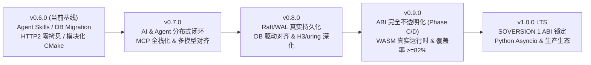

# csilk 演进路线图 (v0.6.0 → v1.0.0 LTS)

> **基线版本**: `0.6.0` | **规划日期**: `2026-11-12` | **目标里程碑**: `v1.0.0 LTS`  
> [English](../../en/meta/ROADMAP.md) | [中文](ROADMAP.md)

---

## 一、当前基线与现状盘点（v0.6.0）

`v0.6.0` 已完成模块化 CMake Target DAG 拆分、HTTP/1.1 & HTTP/2 零拷贝优化、数据库 Flyway 风格迁移引擎、Agent Skills（L1/L2/L3 渐进式披露）、ReAct 自主工具循环、MCP Stdio 进程池及全平台 CI（Ubuntu 24.04 + macOS 15 ARM64 + Wheel 打包）。

通过代码审计，当前仍存在以下待收尾的占位实现（Stub / Placeholder）与演进缺口：

| 领域 | 当前现状 / 已知缺口 | 代码位置 |
| :--- | :--- | :--- |
| **Agent Skill 远端执行** | `csilk_ai_skill_invoke_remote()` 仅发布 `csilk.skill.invoke` 消息即返回 `dispatched`，缺少 Worker 订阅执行器与 `csilk.skill.result` 回收闭环 | `src/workflow/skill.c` |
| **Workflow 集群状态机** | 节点关联与派发校验仍为内存占位实现（Placeholder），尚未接入 WAL 与跨节点恢复 | `src/workflow/wf_cluster_sm.c` |
| **MCP 协议全栈** | Client 工具导入存在 placeholder 注册逻辑；Server 部分方法返回 `Method not implemented`；仅支持本地 Stdio 池，缺远程 SSE/Streamable HTTP 传输 | `src/protocols/mcp/mcp_client.c`, `mcp_server.c` |
| **LLM 驱动一致性** | `openai.c` 已支持流式 `tool_calls` 重组与用量统计；`ollama.c` 尚待对齐；缺乏原生 Anthropic Messages API 驱动 | `src/drivers/ai/` |
| **Raft 持久化** | `raft_wal.c` 与 `raft_snapshot.c` 当前为内存递增索引 stub，尚未实现真正磁盘落盘与日志截断 | `src/messaging/raft_wal.c`, `raft_snapshot.c` |
| **DB 驱动矩阵** | SQLite 与 PostgreSQL 已具备原生 `stmt_prepare` 强类型绑定；MySQL 尚待补齐 `MYSQL_STMT` | `src/drivers/db/mysql.c` |
| **分布式限流 TTL** | Redis 存储后端 `incr` 未返回精确剩余窗口 TTL，分布式限流 `Retry-After` 保守回退为整窗时长 | `src/middleware/sliding_ratelimit.c`, `src/middleware/ratelimit.c` |
| **WASM / WASI 沙箱** | 当前仅做魔数校验与 Host Import stub，未接入真实字节码执行引擎 | `src/core/plugin/wasm_plugin.c`, `wasm_wasi.c` |
| **OTLP 追踪闭环** | `otlp_trace.c` 存在保留 no-op stub，HTTP → DB → AI/Tool 跨模块子 Span 尚未全链路打通 | `src/middleware/otlp_trace.c` |
| **ABI 不透明化收尾** | Phase A/B 已完成，尚待推进 [ABI 演进路线图](../design/abi-opaque-roadmap.md) Phase C（测试/示例迁移）与 Phase D（彻底移除公共布局头、锁定 SOVERSION 1） | `include/csilk/`, `cmake/libcsilk.map` |
| **覆盖率与多核回收** | 当前全库行覆盖率 **69%**（12,609 / 18,281）；本地 GCC ASAN 下 `test_multi_worker` 退出存在连接池/Arena 残留泄漏 | `src/core/server/connection_pool.c`, `.gcovr` |

---

## 二、总体演进路线

---

## 三、分阶段里程碑规划

### 阶段一：v0.7.0 —— AI / Agent 分布式执行闭环与协议完备化

**核心目标**：消除 AI 与 Workflow 子系统的原型占位，形成单机/集群一致的生产级 Agent 运行时。

1. **Agent Skill 远端集群执行闭环（`src/workflow/skill.c`）**
   - 实现 Worker 端 `csilk.skill.invoke` 订阅执行器：校验请求 → 调用有界 `csilk_skill_exec_local()` → 将 stdout/exit_code/truncated 发布至 `csilk.skill.result`。
   - 调用端基于 `csilk_async_op_t` 实现非阻塞异步结果等待、基于 `idem` 键的幂等去重缓存以及节点超时自动 Failover 重试。
2. **Workflow 集群状态机实装（`src/workflow/wf_cluster_sm.c`）**
   - 将当前内存态 placeholder 替换为基于 WAL + `csilk_mq` 的 DAG 执行状态机，支持长耗时 Agent 节点与 HITL（Human-in-the-Loop）人工审批断点在进程重启后的状态恢复。
3. **MCP 协议全栈化（`src/protocols/mcp/`）**
   - 完善 `mcp_client.c`：解析远端 `tools/list` 返回的 JSON Schema，自动映射并注册至 `csilk_tool_registry_t`，消除 placeholder 工具。
   - 完善 `mcp_server.c`：补齐 `resources/list`、`resources/read`、`prompts/list`、`prompts/get` 方法，消除 `Method not implemented`。
   - 新增 **MCP over SSE / Streamable HTTP** 传输层，与现有 Stdio 进程池形成统一的传输抽象。
4. **LLM 驱动对齐与 Anthropic 原生接入（`src/drivers/ai/`）**
   - 新增 **Anthropic Messages API** 原生驱动（支持 Streaming Tool Use、Prompt Caching 头部与 Token 统计），与 Anthropic 语义的 Agent Skills 形成原生配合。
   - 为 `ollama.c` 补齐流式 `delta.tool_calls` 重组与 `csilk_ai_trace_t` 吞吐指标采集，使 OpenAI / Ollama / Anthropic 三大驱动能力对齐。

**验收标准**：
- 新增多节点 MQ 闭环测试验证 `csilk_ai_skill_invoke_remote` 的正常回传、幂等去重与超时故障转移；
- MCP Client/Server 集成测试覆盖 `tools/call`、`resources/read` 及 HTTP/SSE 传输。

---

### 阶段二：v0.8.0 —— 存储/共识持久化实装与高性能 I/O 深化

**核心目标**：将框架内预留的内存态持久化 stub 落盘，并打通三大关系型数据库与底层 I/O 优化。

1. **Raft WAL 与 Snapshot 真实落盘（`src/messaging/raft_wal.c`, `raft_snapshot.c`）**
   - 复用 `mq_wal.c` 的帧格式与 CRC32 校验机制，实现 Raft 日志顺序写盘、批量 `fsync` 刷盘策略、`currentTerm`/`votedFor` 原子元数据持久化。
   - 实现周期性快照文件生成（原子 rename 替换）、日志压缩截断（Log Compaction）与 Follower 安装快照（`InstallSnapshot`）恢复路径。
2. **数据库驱动与限流存储能力对齐（`src/drivers/db/`, `src/middleware/`）**
   - 为 `mysql.c` 实现原生 `stmt_prepare` / `MYSQL_STMT` 强类型参数绑定与二进制结果集读取，使 `csilk_migration_t` 分布式锁与迁移引擎完整覆盖 SQLite / PostgreSQL / MySQL。
   - 扩展 `csilk_storage_driver_t` 的计数接口返回精确剩余窗口 TTL，打通 `redis.c` `PTTL` 返回，令分布式限流返回精确 `Retry-After`。
3. **连接池优雅回收与 `io_uring` / HTTP/3 深化（`src/core/server/`, `src/core/uring/`, `src/protocols/h3.c`）**
   - 排查并修复 GCC ASAN 下 `test_multi_worker` 退出时 `connection_pool.c` 与 `arena.c` 的残留泄漏，确保多 Worker 优雅关闭实现零字节泄漏。
   - 完善 `uring_vector.c`（`writev` 向量零拷贝写入）与 `uring_sqpoll.c`（SQPOLL 轮询线程绑核）在 CI `io_uring` Job 中的真实集成测试，逐步移除 `.gcovr` 排除项。
   - 为 `h3.c` 现有 QUIC Varint/Frame 编解码器提供可选的传输对接层（可选依赖 `ngtcp2` + OpenSSL 3.5 QUIC API），支持端到端 HTTP/3 请求收发试验性特性。

**验收标准**：
- Raft 3 节点杀进程重启恢复测试通过，数据零丢失；
- MySQL 原生预处理与迁移引擎在 CI 容器化集成测试中通过；
- ASAN 下 `test_multi_worker` 零泄漏通过。

---

### 阶段三：v0.9.0 —— ABI 完全不透明化、WASM 沙箱实装与质量冲刺

**核心目标**：完成 `v1.0.0` 前的最后一次破坏性整理，锁定公共边界并将测试质量推至生产冻结线。

1. **完成 ABI 不透明化 Phase C & D（依据 [ABI 演进路线图](../design/abi-opaque-roadmap.md)）**
   - **Phase C**：将仓库内剩余直接访问上下文结构体的 30+ 测试与示例全面迁移至 `csilk_get_*` / `csilk_set_*` 访问器 API，开启 `CSILK_DEPRECATE_CTX_TYPES` 验证无残留依赖。
   - **Phase D**：将 `ctx_types.h` 等内部结构体布局定义完全迁出 `include/csilk/` 至 `src/core/internal/`；审计并收紧 `cmake/libcsilk.map` 导出符号白名单，确保公共头文件 100% 仅暴露不透明句柄。
2. **WASM / WASI 插件沙箱接入真实运行时（`src/core/plugin/`）**
   - 通过 CMake 可选编译选项（`-DCSILK_ENABLE_WAMR=ON`）集成 **WAMR（WebAssembly Micro Runtime）**，替换 `wasm_plugin.c` 与 `wasm_wasi.c` 的占位 stub。
   - 提供插件内存配额上限、执行指令步数预算（防止恶意死循环阻塞 Worker 线程）以及零拷贝读写 HTTP Header/Body/Status 的 Host ABI，支持通过热重载动态加载 `.wasm` 中间件。
3. **全链路 OTLP 追踪闭环与测试覆盖率冲刺（≥ 82%）**
   - 替换 `src/middleware/otlp_trace.c` 中的 no-op stub，串联 `HTTP Request Span` → `DB Query Child Span` → `AI / MCP / Tool Call Child Span` 的 `traceparent` 上下文自动传递，并在 `/admin/apm` 仪表盘展示端到端火焰图。
   - 新增 libFuzzer 目标：`fuzz_mcp`（MCP JSON-RPC 畸形输入）、`fuzz_h2`（HTTP/2 帧状态机）、`fuzz_sql_rewrite`（PostgreSQL 参数重写）；将全库行覆盖率从 **69%** 提升至 **82%+**。

**验收标准**：
- 公共头文件 `include/csilk/` 编译检查零内部结构体暴露；
- 全库行覆盖率 ≥ 82%，7 个 Fuzz 目标持续 120s 零 Crash/UBSAN/ASAN 告警。

---

### 阶段四：v1.0.0 LTS —— ABI 冻结与多语言/包管理生态交付

**核心目标**：交付长期支持版（LTS），保证 `1.x` 周期内的二进制兼容性与开箱即用生态体验。

1. **SOVERSION 1 锁定与自动化 ABI 门禁**
   - 将 `CSILK_VERSION` 提升至 `1.0.0` 并锁定 `SOVERSION = 1`；在 CI 中引入 `libabigail`（`abidiff`）与 `v1.0.0` 基线 `.abi` XML 对比，阻断任何意外的 ABI 破坏。
2. **系统包管理器与发行生态**
   - 推动 `cmake/ports/csilk` 合入上游 **vcpkg** 官方仓库；补充 Conan Center recipe、Homebrew Tap（`quintin-lee/tap/csilk`）及 Debian/Ubuntu PPA 构建脚本。
3. **Python 绑定现代化与 PyPI 自动发布（`python/`）**
   - 补全 PEP 561 `.pyi` 静态类型存根，支持 `mypy` / `pyright` 完整智能提示；提供基于 `asyncio` 的异步中间件与 Agent Workflow 协程桥接。
   - 在 `.github/workflows/wheels.yml` 中配置 PyPI Trusted Publishing（OIDC），实现推送 `v*` 标签自动验证并发布 Linux `manylinux_2_34` 与 macOS `arm64` Wheel 至 PyPI。
4. **开发者脚手架与官方基准白皮书**
   - 升级 `scripts/csilkskel` 与 `scripts/generate-sdk.py`，支持生成含 JWT 鉴权、数据库迁移、OpenAPI 文档与 AI Agent 路由的一体化项目模板及带重试策略的 TypeScript/Python SDK。
   - 发布 `v1.0` 官方性能基准对比报告（在 16 核 Linux `io_uring` 与 `libuv` 模式下，与 Nginx、Drogon、Go `net/http`、Actix-web 对比吞吐、P99 延迟及 10K 连接内存占用）。

---

## 四、近期优先行动清单（v0.7.0-alpha 起点）

| 优先级 | 类别 | 具体任务 | 核心涉及文件 |
| :--- | :--- | :--- | :--- |
| **P0** | 内存安全 | 排查并修复 GCC ASAN 下 `test_multi_worker` 退出时的 Arena / 连接池残留泄漏 | `src/core/server/connection_pool.c`, `src/core/primitives/arena.c` |
| **P0** | AI / Agent | 实现 `csilk_ai_skill_invoke_remote` 的 Worker 端 MQ 订阅执行与 `csilk.skill.result` 超时/幂等回收 | `src/workflow/skill.c`, `tests/drivers/test_ai_skill.c` |
| **P1** | 协议 / MCP | 打通 `mcp_client.c` `tools/list` 到 `csilk_tool_registry_t` 的自动 schema 注册，消除 placeholder | `src/protocols/mcp/mcp_client.c`, `src/drivers/ai/tool_registry.c` |
| **P1** | 数据库 | 为 MySQL 驱动补齐原生 `stmt_prepare` 绑定，实现三大关系型数据库迁移引擎全覆盖 | `src/drivers/db/mysql.c`, `src/drivers/db/migration/` |
| **P2** | 共识 / WAL | 基于 `mq_wal.c` CRC32 帧格式实现 `raft_wal.c` 真实日志写盘与 `fsync` 持久化 | `src/messaging/raft_wal.c`, `src/messaging/raft_snapshot.c` |
